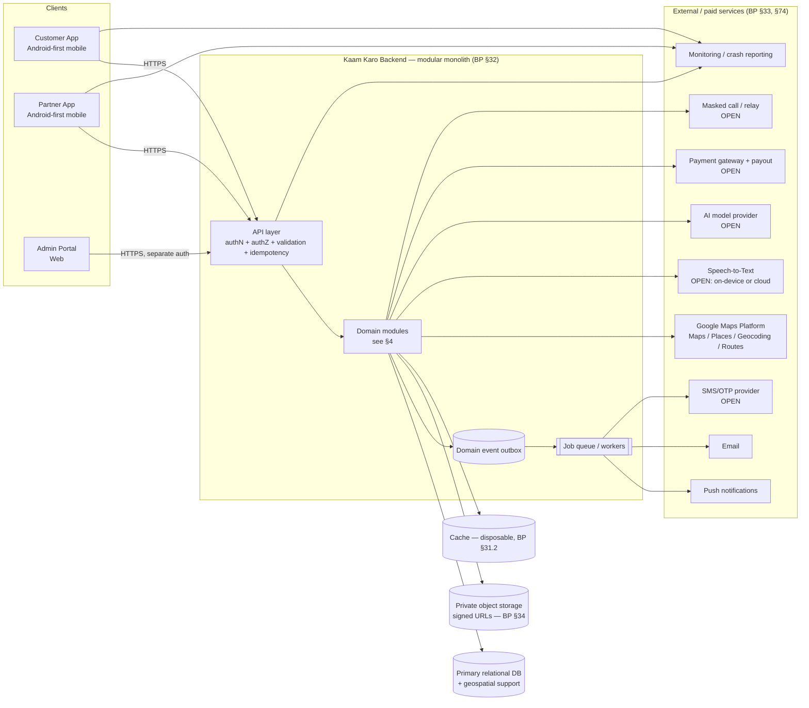

# Kaam Karo — System Architecture

> **Source of truth:** `Kaam_Karo_Product_Blueprint_v0_4_AI_Voice_Language_Device_Integration.docx` (called **"the Blueprint"** below).
> **Companion file:** `implementation.md` (agents, tasks, coordination, bug loop).
> **Document status:** Draft derived from Blueprint v0.4. Owner decisions accepted 2026-10-22: D-001 stack (§17), D-002 phone OTP login, D-003 pay on completion, D-005 customer chooses supplier, D-006 commission 30% platform / 70% provider, D-004 provider states crew size, D-018 crew rules (leader verified, price not per worker), D-007 launch city Lahore, D-019 whole Lahore active from pilot, D-014 low-rating warnings → block below 2.0 average (§6.7), D-015 commission on labour only, D-016 provider records payment method and cash commission is debited from the provider account, D-020 provider with unpaid commission cannot be hired by the next customer, D-021 worker pays the company by any bank/wallet and the block also stops already-accepted jobs from starting (§6.8, §22). Nothing here is built yet (Blueprint, cover page: "Status: STARTING FROM SCRATCH").

---

## 0. Read this first (rules for every human and AI reader)

### 0.1 Authority order

When two statements disagree, the higher item wins:

1. A decision recorded in `coordination/DECISIONS.md` and approved by the product owner.
2. Blueprint **v0.4 layer** (Blueprint §73–§87).
3. Blueprint **v0.3 layer** (Blueprint §52–§72).
4. Blueprint **base foundation** (Blueprint §1–§51).
5. This file.
6. `implementation.md`.

Blueprint §72 makes accepted later layers part of the baseline, which is why newer layers win. Anything the Blueprint marks **Proposed**, **Later**, **Deferred** or **Needs Validation** is **not** launch scope (Blueprint §72, §86). Agents must not build it unless the owner promotes it.

### 0.2 Tag legend used in this file

| Tag | Meaning | What an agent may do |
|---|---|---|
| `[BP §n]` | Stated directly in Blueprint section *n*. | Implement as written. |
| `[DERIVED from §n]` | A necessary consequence of Blueprint §n, not literally stated. | Implement, but keep it minimal and traceable. |
| `[INTERPRETATION]` | The Blueprint is ambiguous and this file picks one reading. | Implement behind config. Confirm with owner (listed in §21). |
| `[STACK]` | Technology choice accepted by the owner in decision D-001 (2026-10-22). It is not from the Blueprint. | Use it. Do not swap or add frameworks without a new owner decision in `DECISIONS.md`. |
| `[OPEN]` | Unresolved business decision. | **Do not invent.** Build the interface + config switch, and log it in `OPEN_QUESTIONS.md`. |
| `[NOT LAUNCH]` | Blueprint says Later / Proposed / Future. | Do not build. At most, reserve an extension point. |

### 0.3 Anti-hallucination rules (architecture level)

1. Every entity, field group, endpoint, status, screen and event must trace to a `[BP §n]` or a `[DERIVED from §n]`. If you cannot cite a section, **stop** and log an open question.
2. Do not invent prices, fees, commission %, cancellation windows, quote validity times, badge thresholds, ranking weights, file-size limits or SLA numbers. The Blueprint deliberately leaves them configurable (BP §7 principle 7, §42, §54.2). Store them in **config tables** seeded with `NULL`/placeholder values plus a `TODO(OWNER)` marker.
3. Do not add categories outside the household boundary (BP §1.4, §63). Medical, legal, financial, childcare/eldercare, recruitment, government and high-risk construction are excluded.
4. Do not name a vendor (payment gateway, SMS, LLM, masked-calling) as decided. Only Google Maps Platform is a named planned dependency (BP §57, §69, §74). Android SpeechRecognizer and Google Cloud Speech-to-Text are named only as **options to evaluate** (BP §77.1).
5. The server is the source of truth for prices, permissions and status (BP §15.1, §29). Clients only request transitions.

---

## 1. Product scope in one page

| Item | Value | Source |
|---|---|---|
| What it is | Smart, hyperlocal, two-sided marketplace for household/everyday services | BP §1.1, §52 |
| Not | A simple provider directory | BP §52 |
| Country | Pakistan only at launch | BP §57.2, §69 |
| Geography | One launch city first: **Lahore** (D-007). **The whole of Lahore is active from the pilot**, not selected neighbourhoods (D-019). Other Pakistani cities are listed but inactive and configurable | BP §6.2, §69; D-007, D-019 |
| Login | **Phone number + OTP** for customers and providers (D-002). Admin keeps strong authentication + MFA (BP §27) | BP §27; D-002 |
| Launch vertical | Household / everyday property, utility, device and mobility-support services | BP §1.3, §63 |
| Active launch set | 8–10 families: Plumbing, Electrical, AC/Cooling, Appliance Repair, Internet/Wi-Fi, TV/Entertainment, Cleaning, Carpentry/Furniture, Locksmith/Access, basic Car Care — **to be validated with real supply/demand** | BP §6 |
| Planning catalog | Full tree in BP §63 (supersedes the older BP §5 table) | BP §63, §72 |
| Excluded | Medical, legal, financial, childcare/eldercare, recruitment, government, high-risk construction, highly sensitive records | BP §1.4, §63, §69 |
| Surfaces | Customer App, Partner App, Admin Portal (web) | BP §60 |
| Roles | Service Taker, Service Provider, Admin (with sub-roles) | BP §1.2, §8.4 |
| Interaction principle | Customer: "Talk, show, tap — don't fill forms". Provider: "See, decide, act" | BP §85 |
| Languages | English + Urdu (RTL, readable Nastaliq/Naskh) | BP §78 |
| Payments | Design for cash + digital in Pakistan; gateway `[OPEN]`; cash-first pilot allowed. **Customer pays at the end, after the job is completed** (D-003) | BP §49, §69; D-003 |
| Commission | **30% platform, 70% provider**, fixed percentage (D-006), charged **only on the worker's labour** (Labor / Service fee lines). Parts, materials and other lines carry no commission (D-015). On cash jobs the provider records the payment method in billing and the 30% is debited from the provider's account (D-016, §6.8). **Until the worker pays the owed commission to the company, the next customer cannot hire them** (D-020) | BP §41, §58.1; D-006, D-015, D-016, D-020 |
| Matching mode | **Customer chooses the supplier** from the ranked list or from received offers. No auto-assign at launch (D-005) | BP §46, §55; D-005 |
| Provider model | A provider can be one worker or a team. **The provider tells the customer how many workers will come** (crew size) on every offer/booking (D-004, §5.6) | BP §7, §55.2; D-004 |
| Rating enforcement | Every completed job gets customer feedback + rating. Low average rating → 1–2 warning alerts → account blocked if it stays low (D-014, §6.7) | BP §19; D-014 |

---

## 2. System context



Key rules shown in the diagram:

- Mobile → API is **HTTPS only**; API → DB over a private network path where supported (BP §34).
- The Admin Portal uses **separate authentication and authorization** from public APIs (BP §34, §60.3).
- Files are **private by default**; access only through signed URLs (BP §34).
- API keys and AI prompts **never** live in client code (BP §29, §67).
- The two mobile apps share **one backend and one set of authoritative records** (BP §60.1).

---

## 3. Client surfaces

### 3.1 Customer App (Service Taker) — BP §60, §12

Purpose: describe the need, discover providers, compare, book or accept offers, communicate, track, pay, review (BP §60).

**Base screens C01–C30 (BP §12):** Splash, Welcome, Login, Register, OTP, Home, Search, Search results, Category, Service detail, Provider profile, Request/booking, Quote, Booking review, Booking confirmation, Payment, Booking tracking, Chat/contact, Job in progress, Completion, Review, My bookings, Addresses, Payments/receipts, Profile, Notifications, Settings, Support, Dispute/report issue, Account deletion.

**Login screens after D-002 (phone OTP):** C03 Login = phone number → OTP (C05). C04 Register = name, phone, city/area, terms, then OTP. No password field anywhere in the customer app. BP §12 also lists email on C04. Email may be kept as an **optional** profile field, but it is never a login method. Whether to collect it at all is `[OPEN]` (OQ to owner).

**Screens required by v0.3/v0.4 that the BP §12 inventory does not list** `[DERIVED]`. They get new IDs so nobody overloads an old screen:

| New ID | Screen | Derived from |
|---|---|---|
| C31 | "What do you need?" conversational request composer (talk / type / photo / video, mixed) | BP §56.1, §79, §85 |
| C32 | Audio note recorder (elapsed + remaining time, pause/stop, replay, delete, re-record; ≈2 min max) | BP §76.1 |
| C33 | Problem video recorder (≈30 s max, estimated file size, pause/delete/re-record, thumbnail) | BP §76.2 |
| C34 | Request summary confirmation (AI interpretation visible + editable) | BP §56.1 step 85, §67, §79 |
| C35 | Supplier match results with comparison controls, map/list toggle, "Why am I seeing this?" reasons | BP §54.3, §55.1 |
| C36 | Multi-supplier offers comparison (structured fare lines + crew size side by side) | BP §53, §58; D-004 |
| C37 | Extra-charge approval sheet (proposed → approve/reject) | BP §52.1, §58.2 |
| C38 | Voice assistant overlay (push-to-talk, listening state, recognized text, undo/cancel, text fallback) | BP §77.4 |
| C39 | Location confirm (detected address, map pin, search, saved address, manual entry) | BP §57.1, §57.3 |
| C40 | No-supply / supply-gap screen (broaden radius, other time, callback, waitlist, related service) | BP §61.3 |
| C41 | Language selection (onboarding + settings) | BP §78.1 |
| C42 | Favorites (saved suppliers, quick rebook) | BP §55.2 ("Favorite" user action) |

### 3.2 Partner App (Service Provider) — BP §60, §13

Purpose: receive requests, quote/accept, manage availability, schedule, navigate, chat, complete jobs, issue charges, track earnings (BP §60).

**Base screens P01–P21 (BP §13):** Provider welcome, Registration, Verification, Provider home, Service setup, Availability, Service area, Job requests, Job detail, Accept/reject/quote, Schedule, Job execution, Extras/materials, Completion evidence, Earnings, Payout methods, Reviews, Provider profile, Notifications, Support, Settings.

**Derived additions** `[DERIVED]`:

| New ID | Screen | Derived from |
|---|---|---|
| P22 | Availability status switch (Online / Busy / Offline / Scheduled Only / Emergency Available) | BP §59.3 |
| P23 | Date-specific availability overrides (open / closed / limited / fully booked / special hours) | BP §59.2 |
| P24 | Structured quote builder (line items per BP §58.1, validity, inclusions/exclusions, duration, **crew size required**) | BP §18, §58; D-004 |
| P25 | Request media player (audio, video thumbnail, photos) inside the job flow | BP §76.1 ("play it without leaving the job flow") |
| P26 | Before/after evidence capture (camera) | BP §74 (Camera row) |

Provider UX rule: Accept / Decline / Quote / Ask a question must take **one or two clear actions** (BP §62.2, §85).

### 3.3 Admin Portal (Web) — BP §14, §60.3

The Admin Portal is the **operational control center**, not just a dashboard (BP §60.3). Screens A01–A20 (BP §14): Admin login, Dashboard, Users, Provider verification, Categories, Services, Bookings, Quotes, Payments, Refunds/disputes, Reviews/moderation, Support, Fees/commissions, Promotions (`[NOT LAUNCH]` per BP §14 "later"), Notifications, Reports, Audit logs, Risk/fraud, System health, Settings.

**Derived additions** `[DERIVED]`:

| New ID | Screen | Derived from |
|---|---|---|
| A21 | Matching weights & fairness configuration | BP §54.2 ("weighting must remain configurable in the Admin Portal") |
| A22 | Badge rules configuration | BP §55.2, §66 (Supplier Badge record) |
| A23 | City & service-zone activation (city exists vs city active) | BP §57.2, §64 |
| A24 | Per-service AI guidance & customer questions | BP §64 |
| A25 | Marketplace health (customer-side + supplier-side) | BP §61 |
| A26 | AI interaction log viewer (what AI suggested vs what was confirmed) | BP §66, §67 |

Admin sub-roles and least privilege (BP §8.4): Super Admin, Operations, Support, Finance, Content Manager, Risk/Trust, Analyst, Technical Admin. Strong authentication, preferably MFA (BP §27).

---

## 4. Backend: modular monolith

BP §32: *"Do not build microservices just because the product might become large. Start with a well-structured modular backend."* So we build **one deployable backend** made of strictly bounded modules. A module may only touch another module's data through that module's public service interface or through domain events. **No cross-module table access.**

| # | Module | Owns (entities) | Main responsibilities | Blueprint |
|---|---|---|---|---|
| M1 | **Identity & Access** | User, Device Session, Admin User, role/permission tables | Phone OTP login for customers/providers (D-002), OTP rate limits + resend limits, admin strong auth + MFA, sessions with expiry + revocation, RBAC, admin sub-roles, account recovery, blocked accounts, deletion lifecycle | §8, §27, §29 |
| M2 | **Profiles** | Customer Profile, Provider Profile, Address, Favorite | Profiles, saved addresses (Home/Work/custom), favorites | §21, §25, §55.2, §66 |
| M3 | **Verification & Trust** | Verification Record, Supplier Badge | Provider levels (Basic / Verified / Business Verified / Specialized Verified), risk-proportional checks, badge computation from configured rules, **low-rating enforcement (warnings → block, §6.7)** | §22, §55.2, §66; D-014 |
| M4 | **Catalog** | Category, Service, provider skill mapping, per-city activation | Category tree, service config (price model, selling modes, inspection/quote flags, emergency allowed, verification required, AI questions), city activation | §4.2, §63, §64 |
| M5 | **Availability & Service Area** | Availability Rule, Service Area | Weekly hours, breaks, date overrides, emergency flag, radius/zones, capacity, live status | §59 |
| M6 | **Location** | Location Snapshot | Geocoding, reverse geocoding, Places autocomplete, distance/ETA, Pakistan boundary enforcement, usage budgets | §57, §81 |
| M7 | **Request & AI Intake** | Customer Request, AI Interaction | Intent detection, service mapping, clarification, summarization, confidence/fallback, AI logs | §56, §67, §79 |
| M8 | **Matching** | Match Candidate | Hard eligibility filter → configurable scoring → fairness → explanations; ranking version stamped | §54, §61, §68 |
| M9 | **Booking & Job** | Booking, Job Event | Booking state machine, transition guards, event history, cancellation/no-show rules | §15, §16 |
| M10 | **Quotes & Fare** | Quote, Fare Line | Quotes (validity, line items), multi-supplier offers, proposed/approved/rejected/final charge states, emergency exception | §18, §53, §58 |
| M11 | **Payments & Settlement** | Payment, Settlement, Refund | Payment state (cash + digital), **payment due only after Completed (D-003)**, idempotent initiation, commission split 30/70 from config (D-006), commission on labour lines only (D-015), provider earnings ledger where cash jobs debit the 30% from the provider's account (D-016, §6.8), reconciliation, payouts, refunds as reversals | §17, §26, §31.2; D-003, D-006 |
| M12 | **Reviews & Reputation** | Review | Reviews only from completed eligible jobs, 1–5 + tags, provider response, flag/report, moderation | §19 |
| M13 | **Communication** | Conversation, Message | In-app chat, masked/relay calling `[OPEN vendor]`, attachment limits + validation, WhatsApp share payloads | §20, §82 |
| M14 | **Media** | media object records (`[DERIVED]`) | Upload sessions, size/duration limits, compression verification, thumbnails, transcripts, retention | §76 |
| M15 | **Notifications** | Notification, templates, user notification preferences | Event → per-role message fan-out, priority, user categories, quiet hours (`[NOT LAUNCH]`) | §24, §80 |
| M16 | **Support & Disputes** | Support Ticket, Dispute | Tickets, L1–L5 escalation, dispute workflow, link to refunds | §12 (C28, C29), §40 |
| M17 | **Admin Ops & Config** | config tables, Promotion (`[NOT LAUNCH]`) | Configurable rules (BP §42), commissions/fees, reports, health views | §39, §42 |
| M18 | **Audit & Events** | Audit Log, Marketplace Event | Append-only audit, actor/action/object/before/after, outbox for domain events | §25, §26, §66 |
| M19 | **Analytics** | analytics events (`[DERIVED]`) | Funnel and marketplace metrics, dual-sided health | §35, §61 |

### 4.1 Module dependency direction (allowed calls)

```
M1 Identity  ←  everyone (authN/authZ only)
M4 Catalog   ←  M7, M8, M9, M10
M5 Availability, M6 Location, M3 Trust  ←  M8 Matching
M7 Intake → M8 Matching → M9 Booking → M10 Quotes → M11 Payments
M9 Booking → (events) → M12 Reviews, M15 Notifications, M16 Support, M19 Analytics
M18 Audit  ←  every module writes; nobody else reads its tables directly
```

Circular calls are forbidden. If M10 needs to change booking state, it calls `BookingService.requestTransition()` and never updates the booking table itself.

---

## 5. Data model

Design around **stable business objects, not screens** (BP §25). The Blueprint names the entities and the important content. Agents may add only these **technical fields** without asking: `id` (UUID), `created_at`, `updated_at`, `version` (optimistic lock), `deleted_at` (soft-delete where the lifecycle needs it), `created_by`. Any other field must cite a Blueprint section.

### 5.1 Entities from BP §25

| Entity | Stores | Relationships |
|---|---|---|
| User | Login identity, common profile | Has one or more roles |
| Customer Profile | Customer-specific info | Belongs to User |
| Provider Profile | Identity, business, trust data | Belongs to User; has Services |
| Admin User | Staff access | Belongs to User; has permissions |
| Address | Saved/job address | Belongs to Customer; **copied** into job snapshot |
| Category | Hierarchy | Parent/child |
| Service | What is sold | Belongs to Category / Provider |
| Service Area | Where provider serves | Provider + geographic scope |
| Availability | When provider serves | Provider / Service |
| Booking | Customer demand record | Customer + Service + Provider/assignment |
| Quote | Commercial offer | Booking + Provider |
| Job Event | History of state/action changes | Booking/job |
| Payment | Transaction state | Booking + customer/provider |
| Settlement | Provider payout state | Provider + Payment(s) |
| Review | Customer feedback | Completed booking + Provider |
| Conversation | Channel | Booking participants |
| Message | Individual message | Conversation |
| Support Ticket | Support case | User + Booking (if relevant) |
| Dispute | Formal transaction issue | Booking + parties |
| Refund | Return of funds | Payment / Booking |
| Notification | Delivered message/event | User + event |
| Promotion | `[NOT LAUNCH]` | Service / Category / segment |
| Audit Log | Security/business change history | Actor + action + object |
| Device Session | Login/device management | User |
| Verification Record | Verification checks | Profile + verification state |

### 5.2 Records added by v0.3 (BP §66)

| Record | Important information (verbatim scope) |
|---|---|
| Customer Request | customer, intent, service, description, AI interpretation, attachments, location, requested time, urgency, status |
| Match Candidate | request, supplier, eligibility result, distance/ETA, availability result, match reason, **ranking version** |
| Quote | supplier, request, validity, line items, taxes/fees, customer response, approval status, timestamps |
| Fare Line | type, description, amount, who proposed it, approval status, evidence/notes, applicable rules |
| Availability Rule | provider, normal schedule, exceptions, date-specific slots, zone, emergency flag |
| Supplier Badge | badge type, eligibility rule, effective date, expiry/recalculation status, source metrics |
| Favorite | customer, provider, created date, optional notes |
| Location Snapshot | address label, lat/long, accuracy estimate, place/address reference, confirmation status |
| AI Interaction | request/session, model/service version, prompt/input class, output summary, safety/approval state, latency/error metrics |
| Marketplace Event | actor, action, object, timestamp, previous state, new state, source/device metadata where needed |

### 5.3 Derived records `[DERIVED]`

| Record | Why it must exist | Source |
|---|---|---|
| MediaObject (kind = audio/video/photo/document, duration, size, mime, thumbnail ref, transcript ref, retention_until, scan status) | Audio/video limits, thumbnails, transcripts and retention rules need a record | BP §76, §20 |
| ConfigRule (key, scope = global/city/category/service, value, effective_from, changed_by) | All rules in BP §42 and §64 must be configurable | BP §42, §64 |
| NotificationPreference (user, category, enabled) | Users control notification categories | BP §74, §84 item 116 |
| City (name, is_listed, is_active) and ServiceZone | "A city can exist in the product even when the marketplace is not yet active there" | BP §57.2 |
| IdempotencyKey | Booking creation and payment initiation must be idempotent | BP §31.2 |
| OutboxEvent | Queue-based notifications and background work that are not lost | BP §24, §31.2 |

### 5.4 Data ownership rules (BP §26) — enforced at DB level

1. Transaction records stay traceable even after profile deletion (anonymize the person, keep the transaction).
2. A profile change never rewrites history. A booking stores an **address snapshot** (BP §21).
3. Financial records are immutable. Corrections are **reversal/adjustment rows**, never `UPDATE amount`.
4. Audit logs are **append-only** (DB permissions: no UPDATE/DELETE grant for the app role).
5. User deletion follows a defined lifecycle (request → grace/hold → anonymize), not an immediate cascade delete.

### 5.5 Two orthogonal service configuration fields `[INTERPRETATION]`

BP §4.1 defines **price models** (Fixed / Starting-"From" / Inspection-quote). BP §53 defines **commercial selling models** (Instant/Catalog, Choose from Suppliers, Request Quotes/Offers), and says a service can be a hybrid. This file reads them as two independent settings on each Service:

- `price_model ∈ {FIXED, FROM, INSPECTION_QUOTE}` — how the price is expressed (BP §4.1, §17).
- `selling_modes ⊆ {INSTANT, CHOOSE_SUPPLIER, REQUEST_QUOTES}` — which customer flows are allowed (BP §53).
- `visit_fee` / `inspection_fee` optional, flagged as deductible or not (BP §58.1).

Owner confirmation required → listed as conflict **K-08** in §21.

### 5.6 Crew size — owner decision D-004 (2026-10-22)

Owner's rule, in the owner's words: the worker tells the customer how many people (workers) will come, and mentions it.

| Where | Field / rule | Status |
|---|---|---|
| Quote / offer (M10) | `crew_size` (integer ≥ 1), **required** when the provider sends an offer or quote | Accepted |
| Booking (M9) | `crew_size` copied from the accepted quote, or entered by the provider when accepting an instant / choose-supplier booking | Accepted |
| Customer screens C35, C36, C14, C15, C17 | Show "N workers will come" before the customer chooses and on the booking afterwards | Accepted |
| Change after acceptance | A new crew size needs customer-visible approval, like any scope change (BP §18 step 62) | `[DERIVED from §18]` |
| Provider profile | Optional "usual team size" display; the "Large Team / Company Provider" badge (BP §55.2) needs a rule in config | Badge rule `[OPEN]` (D-010) |
| Price per worker? | **No.** Crew size never changes the price. Price depends on the **nature of the work** (the service and the job), through the service's price model and the quote's fare lines (BP §4.1, §58.1). No pricing code may read `crew_size` | Accepted D-018 |
| Identity of each team member | **Only the team leader** is verified. The team leader is the provider account holder, who goes through normal provider verification (BP §22). Other team members are not registered or verified in the app at launch | Accepted D-018 |
| Team leader on the job | The verified team leader is the person responsible for the booking and is shown to the customer on the provider profile/booking | `[DERIVED from D-018]` |

---

## 6. State machines

### 6.1 Booking / Job — BP §15 (exact)

One controlled status at a time. Every change is written as a **Job Event** (BP §15). The client never sets status (BP §15.1).

| Status | Meaning | Allowed next (BP §15) |
|---|---|---|
| Draft | Customer has not submitted | Requested, *Abandoned*¹ |
| Requested | Customer submitted | Accepted, Rejected², Expired, Cancelled |
| Quote Pending | Provider must price or inspect | Quoted, Rejected², Expired, Cancelled |
| Quoted | Quote waiting for customer | Accepted, *Declined*¹, Expired |
| Accepted | Provider accepted booking/quote | Scheduled, Cancelled |
| Scheduled | Appointment set | Provider En Route, Cancelled, No-show² |
| Provider En Route | Provider travelling | Arrived, Cancelled, No-show² |
| Arrived | Provider at location | In Progress, Cancelled |
| In Progress | Work being done | Awaiting Approval, Completed, Disputed |
| Awaiting Approval | Customer/extra-charge approval needed | In Progress, Completed, Disputed |
| Completed | Work finished and recorded | *Reviewed*¹, Disputed |
| Disputed | Issue raised | *Resolved / Refunded / Rework*¹, Closed |
| Cancelled | Ended before completion | Closed |
| Expired | Required action not taken in time | Closed |
| Closed | Lifecycle complete | — |

¹ **Blueprint gap (conflict K-05):** *Abandoned, Declined, Reviewed, Resolved, Refunded, Rework* appear as "next states" but are not defined as statuses. **Default reading** `[INTERPRETATION]`:
- *Abandoned* → Draft is deleted or expired by a cleanup job; it is **not** a status.
- *Declined* (customer declines quote) → recorded as `Quote.customer_response = DECLINED`. Booking → `Cancelled` with reason `QUOTE_DECLINED`, or stays open if other offers exist (multi-quote, BP §53).
- *Reviewed* → a **flag** (`review_submitted_at`) on a Completed booking, not a status.
- *Resolved / Refunded / Rework* → **Dispute outcomes** stored on the Dispute record. Booking goes `Disputed → Closed`, or `Disputed → In Progress` for Rework.

³ **Quote Pending entry (D-028, K-16):** Draft → Quote Pending when the customer submits on a quote-required/inspection service; Requested → Quote Pending when the provider chooses Quote. The inspection visit happens while the booking is in Quote Pending; its time is stored on the booking.

² **Blueprint gap:** *Rejected* and *No-show* are named as targets but not listed as statuses. **Default reading:** Rejected → terminal status `Rejected` → `Closed`. No-show → terminal status `No-show` with `party = CUSTOMER|PROVIDER` → `Closed` (BP §16 treats customer and provider no-show differently).

Implementation: a single transition table in code, `allowedTransitions[from][to] = {actorRoles, guards}`, covered by a test for **every** row (BP §43 rule 68: tests for critical business rules).

### 6.2 Customer Request (v0.3) `[DERIVED from §56, §66, §79]`

`Composing → Interpreting (AI) → NeedsClarification ↔ Interpreting → AwaitingConfirmation → Submitted → Matching → MatchesShown | NoSupply → (Booking created per chosen supplier or per quote request)`.

The AI may only move a request to `AwaitingConfirmation`. **Only the customer** moves it to `Submitted` (BP §67, §77.3).

### 6.3 Fare line / extra charge — BP §58.2 (exact)

`Proposed → Approved | Rejected`. Approved lines are summed into `Final` at completion. A provider **cannot** turn a `Proposed` line into a payable amount. Emergency exception (BP §58.3): only for categories with `emergency_allowed = true`. It must be narrowly defined, logged with a reason, communicated to the customer, and **must not** become a loophole. The exact emergency rules are `[OPEN]` (K-10).

### 6.4 Provider verification — BP §22.1

`Basic → Verified → Business Verified`. `Specialized Verified` is for selected technical categories **later**. Requirements are per category and risk-proportional (BP §22.1, §42). The required documents per category are `[OPEN]` and set in config.

### 6.5 Provider availability status — BP §59.3

`Online/Available`, `Busy`, `Offline`, `Scheduled Only`, `Emergency Available`. `Busy` can be set automatically when the capacity limit is reached (BP §54.1 rule 79, §59.1).

### 6.6 Quote — BP §18, §58.2 `[DERIVED]`

`Draft → Sent → (Accepted | Declined | Expired | Withdrawn)`. After acceptance, any price/scope change needs a customer-visible approval (BP §18 step 62).

### 6.7 Provider low-rating enforcement — owner rule D-014 (2026-10-22)

Owner's rule, in the owner's words: every worker gets feedback and a rating from the customer. If the rating drops below a certain point, the worker first gets one or two alerts. If the rating still stays low, the account is blocked.

Every customer rating used here must come from an **eligible completed job** (BP §19). Ratings that admin removed in moderation do not count.

```
Good standing ──(avg rating < threshold)──► Warning 1 ──(still < threshold after review period)──► Warning 2
     ▲                                          │                                                     │
     └──────────(avg rating ≥ threshold)────────┴──────────────(avg rating ≥ threshold)───────────────┤
                                                                                                      │
                                                         (still < threshold after review period)      ▼
                                                                                    Blocked (low rating)
                                                                                    └─ admin can reinstate (audited, BP §8.3)
```

| Item | Value | Status |
|---|---|---|
| Warnings before block | Config `rating.warnings_before_block`, seeded **2** ("aik do bar") | Accepted; owner may set 1 |
| Rating threshold (the "certain point") | Config `rating.block_threshold` seeded **2.0**. Rule: average rating **below 2.0** (strictly less than 2.0) starts the warnings | Accepted 2026-10-22 (D-017 partly) |
| Minimum number of ratings before the rule applies | Config `rating.min_reviews_for_enforcement` = `null`, `TODO(OWNER)` | `[OPEN]` D-017 (prevents blocking a new worker after one bad review) |
| Time between warning and next check (review period) | Config `rating.review_period_days` = `null`, `TODO(OWNER)` | `[OPEN]` D-017 |
| Rating window (all-time vs last N jobs / days) | Config `rating.window` = `null`, `TODO(OWNER)` | `[OPEN]` D-017 |
| Does going back above the threshold reset the warning count? | Diagram assumes **yes** | `[INTERPRETATION]` confirm (D-017) |
| Block action | Automatic by system job; reason `LOW_RATING`; audited; provider notified; removed from matching by hard rule 73 (BP §54.1) | Accepted |
| Effect on already scheduled jobs when blocked | `[OPEN]` D-017 (options: let them finish / cancel with customer re-match / admin decides) | `[OPEN]` |
| Appeal / reinstatement | Admin (Operations or Risk/Trust sub-role) can reinstate with a reason; audited | Reinstate is BP §8.3. Appeal flow `[OPEN]` |

Events: `provider.rating_warning` (to provider, high priority, en/ur) and `provider.blocked_low_rating` (to provider + admin queue).

### 6.8 Commission and provider account — owner decisions D-006, D-015, D-016 (2026-10-22)

Owner's rules, in the owner's words: the 30% commission is charged on the worker's labour. For cash payments, the worker states in the billing how the bill was paid, and the money is deducted from the worker's account.

**Commission base (D-015):** only fare lines of type **Labor / Service fee** (BP §58.1) are commissionable. All other line types carry **no** commission: visit/call-out, inspection, tools/equipment, consumables, parts/materials, emergency/after-hours, travel surcharge, platform fee, tax and discount.

> `[INTERPRETATION]` Visit, inspection and emergency fees are not "labour" in BP §58.1, so they are excluded. If the owner wants them included, add their types to config `commission.base_line_types` (seeded `["LABOR"]`). Whether a discount reduces the labour amount before commission is `[OPEN]` (D-022).

**Payment method recorded at billing (D-016):**

```
Booking Completed
   │
   ▼
Provider opens final bill (P14/P15) → selects "How was it paid?"  { CASH | DIGITAL }
   │                                                   │
   │ CASH                                              │ DIGITAL (via gateway)
   ▼                                                   ▼
Customer paid the worker directly.               Platform receives the full bill.
Ledger: DEBIT provider account                   Ledger: CREDIT provider account
        = 30% × labour lines                             = bill − 30% × labour lines
   │                                                   │
   └───────────────► Provider earnings account (immutable ledger rows, BP §26) ◄──┘
                     balance = credits − debits → payout when positive (Settlement)
```

**Worked example** (amounts only for illustration; real amounts come from the quote):

| Line | Amount (Rs.) | Commissionable? |
|---|---|---|
| Labour / service fee | 2,000 | Yes |
| Parts / materials | 1,500 | No |
| Visit fee | 300 | No |
| **Bill total** | **3,800** | |
| Commission 30% × 2,000 | **600** | |
| Provider's share | **3,200** (70% of labour = 1,400 + parts 1,500 + visit 300) | |

- Cash → the worker already holds Rs. 3,800. A ledger **debit of Rs. 600** is written to the worker's account.
- Digital → the platform holds Rs. 3,800. A ledger **credit of Rs. 3,200** is written to the worker's account.

**Rules:**
- Ledger rows are append-only. Corrections are reversal rows, never edits (BP §26).
- A digital payment is confirmed by the gateway, never by the provider's word. A provider can only record `CASH` for a booking that has no confirmed digital payment.
- The provider sees every debit and credit in Earnings (P15). Finance sees all of it in the admin Payments screen (A09).
- **Unpaid commission blocks new hiring (D-020, owner's words: until the worker pays the previous payment to the company, the next customer cannot hire them).** The account balance can go negative after a cash job. While the balance is **below zero** (config `ledger.max_negative_balance` seeded **0**):
  - the provider is removed from matching results (extra hard eligibility rule, §9);
  - the provider cannot accept a booking, send a quote/offer, or be rebooked from a customer's Favorites;
  - the Partner App shows the amount owed and a "Pay company" action;
  - as soon as the payment to the company is confirmed and the balance is ≥ 0, the provider is eligible again automatically.
  - This is **not** the low-rating block (§6.7) and is not a suspension: the account works normally for everything else (earnings history, support, profile, existing chats).
- **The block also covers jobs that were already accepted (D-021).** While the balance is below zero, the provider cannot **start** any booking: the transitions `Scheduled → Provider En Route` and `Arrived → In Progress` are refused with `UNPAID_COMMISSION`. The provider sees "Pay Rs. X to start this job".
  - `[INTERPRETATION]` If the commission is still unpaid when the appointment time arrives, the booking is treated like a **provider cancellation** under BP §16: the customer gets a clear replacement/refund path and the provider's reliability record is affected. The exact grace time is config `ledger.unpaid_start_grace_minutes` = `null`, `TODO(OWNER)` (D-022).
- **How the worker pays the company (D-021):** through **any bank or mobile wallet** (bank transfer, JazzCash, Easypaisa, etc.) to the company's account. Flow `[DERIVED]`, because the system must know the money really arrived:
  1. Partner App → "Pay company" shows the amount owed and the company's account details (from config, set by Finance).
  2. The worker sends the money from their own bank/wallet app, then enters the **transaction ID** and optionally attaches a **screenshot** (system photo picker, BP §75 item 97).
  3. The submission goes to the Finance queue in the Admin Portal (A09 Payments).
  4. Finance verifies it against the company account and approves or rejects with a reason. Approval writes an audited **credit** ledger row (BP §26).
  5. The balance becomes ≥ 0 → the provider is eligible again automatically → `provider.balance_cleared`.
  - Later, if a payment gateway with bank/wallet collection is chosen (D-008), step 4 can be confirmed automatically. The ledger rules stay the same.
  - The worker's own claim never clears the block. Only a Finance-approved or gateway-confirmed credit clears it.
  - How fast Finance must verify (a worker cannot work while waiting) is `[OPEN]` (D-022).
- Practical note: with this rule, a worker who only takes cash jobs must clear the commission after each cash job before the next hire, so the "Pay company" step must be fast and work on a phone.
- This is the provider's **earnings account** (BP §13 P15 "pending/available/paid"). It is not the customer wallet/credits feature, which BP §46 marks **Later** (see K-15).
- `[INTERPRETATION]` The customer completion screen (C20) shows "Paid by: Cash/Digital" as recorded, so a wrong entry can be reported through the normal dispute flow (BP §16, §40). Confirm with owner (D-022).

---

## 7. Domain events and notifications

Notifications are **event-based, not coded into screens** (BP §24). Each module writes events to the **outbox** in the same DB transaction as the state change. Workers fan them out.

| Event | Customer | Provider | Admin | Priority | Source |
|---|---|---|---|---|---|
| `request.submitted` | Confirmation | New job alert (matched providers) | Operational record | High | §24, §80 |
| `quote.received` | Quote received / compare options | Quote submitted | Record | High | §24, §80 |
| `booking.accepted` | Supplier accepted your request | Job accepted / scheduled | Update metrics | High | §24, §80 |
| `booking.reminder` | Upcoming service | Upcoming job | — | Medium | §80 |
| `provider.en_route` | Provider is on the way / ETA | Navigation / job start | Optional exception | High | §24, §80 |
| `job.status_changed` | Started / completed | Customer confirmed / completed | Update | High | §80 |
| `charge.proposed` | Approval needed | — | — | High | §58.2 `[DERIVED]` |
| `payment.succeeded / failed`, `refund.issued` | Receipt / failure / refund | Settlement status | Financial event | High | §24, §80 |
| `message.new` | New message | New message | — | Medium | §80 |
| `dispute.opened / updated` | Case update | Case update | Case queue | Medium | §24, §80 |
| `provider.rating_warning` | — | "Your rating is below the required level" (warning n of N) | Risk/Trust queue | High | D-014 |
| `provider.blocked_low_rating` | — | Account blocked + reason + how to contact support | Risk/Trust queue | High | D-014 |
| `provider.commission_debited` | — | "Rs. X commission debited for booking #…" | Ledger record | Medium | D-016 |
| `provider.balance_negative` | — | "Pay Rs. X to the company to receive new jobs" | Finance queue | High | D-016, D-020 |
| `provider.commission_payment_submitted` | — | "Payment submitted, waiting for verification" | Finance verification queue | High | D-021 |
| `provider.commission_payment_rejected` | — | "Payment could not be verified: <reason>" | Ledger record | High | D-021 |
| `provider.balance_cleared` | — | "Payment received, you can receive new jobs again" | Ledger record | High | D-020 |
| `promotion.*` | Optional offer | Optional opportunity | — | Low, `[NOT LAUNCH]` | §80 |

Rules: user-controllable categories; critical vs non-critical priority (BP §84 item 116). Ask for Android 13+ notification permission **contextually**, ideally after a meaningful event such as a first booking (BP §75 item 96, §80). Do not make growth depend on spammy notifications (BP §36).

---

## 8. API design rules

1. **AuthZ on every protected action, server-side** (BP §29). Deny by default.
2. **Never trust client values** for price, permission or status (BP §29). The client sends intent (`serviceId`, `quoteId`, `transition: "ACCEPT"`); the server computes amounts.
3. **Idempotency keys** are required on: create booking, submit request, initiate payment, accept quote, approve charge (BP §31.2). A repeated tap returns the original result (BP §31.1).
4. **Validate all input on the server** (BP §29).
5. **Rate limit** login, OTP, messaging and other abuse-prone endpoints (BP §29, §30).
6. **Pending/unknown is a valid response state.** The app must never show "success" until the server confirms (BP §31.1).
7. **Contract-first:** every endpoint and event payload lives in `contracts/` (OpenAPI + event JSON schemas) before code is written (see `implementation.md` §3).
8. **Requirement IDs** follow `AREA-TOPIC-NNN` (e.g. `BOOK-STATUS-012`) per BP §48. Each endpoint description lists the requirement IDs it serves.
9. **Timeouts + retry + failure state + fallback** on every network-dependent operation. No single AI/map/media/notification call may freeze the app (BP §62.3).

---

## 9. Matching engine — BP §54, §61, §68

```
Customer Request (confirmed)
   │
   ▼
[1] Hard eligibility filter (all must pass) — BP §54.1
      73 account active, not suspended
      74 has requested service or configured equivalent skill
      75 serves city + zone/radius
      76 available for time window, OR allowed to receive for later confirmation
      77 meets the service's verification requirement
      78 not blocked from this customer by an active safety/dispute rule
      79 under active-job capacity (if capacity rules enabled)
      +  owner rule D-020: provider account balance ≥ −ledger.max_negative_balance (seeded 0),
         i.e. no unpaid commission owed to the company (§6.8)
   │
   ▼
[2] Scoring with ADMIN-CONFIGURABLE weights — BP §54.2
      distance/ETA, availability fit, exact vs related service match,
      customer preferences, verification, rating quality+volume,
      relevant completed jobs, response speed, cancellation/no-show history,
      repeat-customer signal (when statistically meaningful),
      price competitiveness, reliability/compliance
   │
   ▼
[3] Fairness layer — BP §54.2, §68
      new-provider exposure rule; anti-monopoly cap;
      paid placement can NEVER override relevance/safety/eligibility
   │
   ▼
[4] Explanations — BP §54.3
      "2.1 km away", "Available at your requested time", "Verified electrician", …
   │
   ▼
Match Candidates saved with ranking_version (BP §66)
   │
   ├── zero candidates → Supply-gap flow (BP §61.3)
   └── shown as a "small set of highly relevant suppliers first" (BP §55.1)
```

- **The customer chooses** (D-005). Matching only ranks and explains. It never assigns a job to a provider by itself. For quote-based services the customer invites several eligible suppliers and picks one offer (BP §53). Auto-assign is **not** built at launch.
- **No permanent hard-coded formula** (BP §54.2). Weights live in `ConfigRule` and are versioned. Every Match Candidate stores the `ranking_version` used.
- Weight values, the size of the "small set" and fairness caps are `[OPEN]`. Seed placeholder values marked `TODO(OWNER)` and make them visible in A21.
- Manual overrides of ranking, suspension or dispute outcomes must write an audit entry (BP §68).

---

## 10. AI layer — BP §56, §67, §77

### 10.1 Responsibilities (BP §56.3)

Intent detection · service mapping to the catalog · minimal clarification · photo context (optional, when supported) · location interpretation · time interpretation ("aaj shaam", "kal subah") · supplier-ready summary · suggested supplier filters · post-job invoice/quote explanation · support triage.

### 10.2 Governance (BP §67) — hard rules in code

| Rule | Enforcement |
|---|---|
| AI assists; it never silently makes irreversible decisions | AI endpoints can only write **drafts**. Commit actions need a separate user-initiated call. |
| Never hide an AI interpretation that changes the request | C34 always shows it; the customer can edit the service. |
| Do not invent prices, credentials or customer details | AI output schema has **no price fields**; prices come only from Catalog/Quotes. |
| No unreliable diagnosis claims | Output must use "likely service" language; there is no "diagnosis" field. |
| Confidence/fallback | `confidence` returned. Below the threshold (`[OPEN]` config) → ask a question or show the normal form. |
| Version stamping | Every AI Interaction stores the model/service version. |
| Prompts/secrets server-side only | AI provider is called only from the backend. |
| Moderation of text/images/chat | Moderation step before content reaches the other party. |
| AI failure is non-fatal | Every AI step has a manual path. The customer can always finish without AI (BP §62.1). |

### 10.3 Voice assistant (BP §77)

- Languages: English, Urdu, and natural code-switching where recognition supports it. Show the detected/selected language (BP §77.1).
- MVP is **push-to-talk / explicit start-stop**. **No always-listening wake word** (BP §77.4).
- Allowed actions (BP §77.3): navigate, search, create/edit a draft request, suggest/confirm location, apply **non-sensitive** preferences (time, price range, badges), read out a quote/booking summary, explain badges/fees/statuses, open support and summarize an issue before submission.
- **Confirmation is mandatory** before: placing a booking, accepting a quote, paying, cancelling, or submitting a consequential complaint (BP §77.3).
- Show recognized text before applying important commands; support "undo / cancel that"; every voice function has a text fallback (BP §77.4).
- STT engine: `[OPEN]` — evaluate Android SpeechRecognizer (incl. on-device) vs Google Cloud Speech-to-Text (Urdu-PK and English-PK are documented) (BP §77.1).

### 10.4 Provider-agnostic interface

```
interface IntakeAI {
  interpret(input: {text?, transcriptRef?, photoRefs?, locale, cityId}) -> {
    candidateServices: [{serviceId, confidence}],
    missingFields: [...], clarifyingQuestion?: {text, locale},
    timeHint?: {from, to, raw}, locationHint?: {...}, summary: {text, locale},
    modelVersion, latencyMs
  }
}
```

The output schema is **closed**. Unknown fields are dropped. `serviceId` must exist in the Catalog or it is discarded (this is the anti-hallucination guard at runtime).

---

## 11. Media pipeline — BP §74, §76

| Media | Limit | Client | Server |
|---|---|---|---|
| Customer audio note | ≈ 2 min (exact max = config) | Recorder with elapsed/remaining, pause/stop, replay, delete, re-record; compress to mono speech-quality before upload | Verify duration + size; optional transcript; original **not kept forever** (retention = config `[OPEN]`) |
| Customer problem video | ≈ 30 s; 720p-class default | Compress on-device, show estimated size, pause/delete/re-record | Enforce duration **and** max size; generate thumbnail |
| Photos | 1+ optional (mandatory only if the service requires it) | **System photo picker** (no broad media permission) | Resize/compress previews; do not keep full resolution unnecessarily |
| Provider documents | As required by category | System document picker | Private storage, verification access only |
| Chat attachments | Size- and type-limited | — | Scan/validate (BP §20) |

Exact bitrate, max MB and retention periods are not in the Blueprint → `[OPEN]` (K-11). Seed as config and mark `TODO(OWNER)`.

Upload flow: `create upload session → signed URL → client uploads → server finalize (validate type/size/duration) → thumbnail/transcript jobs → attach to request`. If the upload fails, the **draft request survives** and the app offers retry (BP §76.2, §84 item 112).

---

## 12. Location — BP §21, §57, §81

- Ask for permission **only when needed** (find nearby providers or confirm an address). Foreground/current location preferred (BP §57.1, §75).
- Suggest, do not lock: "We think you are in Lahore" (BP §57.3).
- Correction paths: map pin, search, saved address, manual entry (works with permission denied) (BP §21, §57.1).
- Pakistan-only boundary enforced server-side. City *listed* ≠ city *active* (BP §57.2).
- Store only the location detail needed (BP §57.1 item 91). Providers see only what is needed for the job (BP §21). Pre-match providers do **not** get unnecessary private customer info (BP §52.2).
- Provider location: no continuous collection by default. Active-job/navigation only, with a clear indicator. **Background location is avoided** unless an approved active-job feature needs it (BP §57.4, §81).
- Navigation = hand-off to the chosen navigation app (BP §81).
- Google Maps Platform: restricted API keys, quotas, usage monitoring, budget alerts, field selection (BP §71, §74).

---

## 13. Localization & accessibility — BP §37, §38, §78

- Locale is a first-class config/data concern. Translatable text is stored **separately from logic** (BP §37). Service names come from the backend, not hard-coded in screens.
- `en` and `ur`. Default from onboarding choice or device language; changeable any time (BP §78.1). The Admin Portal is English only (D-026).
- Urdu: professional font (Noto Nastaliq Urdu is the candidate, final choice after device tests), generous line height, full RTL mirroring of alignment/icons/arrows/control order/sheets, no careless mixed-script labels, tested on small, low-cost Android phones (BP §78.2).
- Voice language follows the app language by default. Spoken requests are summarized in the app language (BP §78.3).
- Accessibility: readable sizes, contrast, large tap targets, status never shown by colour alone, icon labels, actionable errors, poor-network states (BP §38).
- Local currency (PKR) and local date/time conventions (BP §37).

---

## 14. Security & privacy baseline — BP §28, §29, §30, §75

| Control | Rule |
|---|---|
| Transport | HTTPS everywhere |
| Auth | Trusted auth service. **Never store raw passwords.** Sessions expire and can be revoked. Admin uses MFA. |
| Authorization | Server-side, least privilege, admin sub-roles |
| Secrets | Secret manager. Never in source control or app binaries (BP §29, §43 rule 69). |
| Payments | Card data handled by the gateway only |
| Audit | All important admin + financial actions |
| Environments | dev / staging / prod separated |
| Backups | Automated + **tested restore** |
| Permissions | Just-in-time. **Never request:** contacts, call logs, Bluetooth, calendar, background location "because they may be useful someday" (BP §75 item 98). |
| Phone/WhatsApp | Launched as **actions/intents** (ACTION_SEND, dialer). The app never reads other apps' data (BP §74, §82). |
| Biometrics | `[NOT LAUNCH]`. If added: device APIs only, no biometric data stored. |
| Abuse | Protections per BP §30 table: fake provider/customer, spam, fake reviews, price manipulation, off-platform leakage, payment fraud, harassment, account takeover, admin abuse |

---

## 15. Reliability — BP §31, §62

- App: useful errors (never a blank screen), safe retry, duplicate-tap protection, local drafts for important forms, explicit pending/unknown state.
- Backend: retries only for safe operations; idempotency; queues for notifications/background work; DB transactions around money; health checks; tested restores; caches separate from critical data.
- RPO/RTO targets are `[OPEN]` and must be agreed **before launch** (BP §31.3).
- Performance budgets for AI, maps, media and notifications are required (BP §84 item 120). Numbers are `[OPEN]`; agents propose them in `DECISIONS.md`.

---

## 16. Environments & infrastructure — BP §34

| Area | Baseline |
|---|---|
| Environments | development, staging/test, production — separate data and keys |
| Admin panel | Separate auth/authorization path |
| File storage | Private by default; signed access |
| DNS | Managed domain, secure configuration |
| Monitoring | Centralized errors, latency, uptime and **important business failures** (e.g. payment stuck, no-match spike) |
| Backups | Automated + tested restoration |
| Region | One primary region at launch (BP §32) |

### 16.1 Scale stages (BP §32)

| Users | Emphasis |
|---|---|
| 0–10k (launch) | Managed backend, one region, simple services, strong logging |
| 10k–100k | Caching, better search/indexing, background jobs, observability |
| 100k–1M | Horizontal API scaling, DB read optimization, queues, CDN/media |
| 1M+ | Split services only where justified, partitioning, regional infra, SRE |

---

## 17. Technology stack `[STACK]` — ACCEPTED (decision D-001, 2026-10-22)

The Blueprint does **not** pick technologies. It does constrain them: Android-first (BP §49, §74), separate customer/partner apps (BP §60), web admin (BP §60), modular backend (BP §32), managed services where possible (BP §32, §27), geospatial matching (BP §54), queues (BP §31.2), Google Maps (BP §57). The stack below satisfies those constraints and was **accepted by the product owner on 2026-10-22**. It is an owner decision, not a Blueprint fact.

**Acceptance condition:** the first task after G0 is an Urdu Nastaliq smoke test (implementation.md T0.6). If Nastaliq rendering fails on the target low-cost Android phones, A00 reopens D-001. Do not switch frameworks silently.

| Layer | Accepted choice | Why it fits the Blueprint |
|---|---|---|
| Repo | Monorepo (pnpm workspaces + Turborepo) | Shared contracts/types across 2 apps + admin + backend |
| Language | TypeScript everywhere | One language for all agents; shared types from `contracts/` |
| Mobile apps | React Native (Expo dev builds), 2 separate app projects sharing UI/i18n packages | Two apps (BP §60) with shared code; RTL via I18nManager; custom fonts for Nastaliq |
| Admin | Next.js (web) | Web portal (BP §60) |
| Backend | NestJS modular monolith | Matches BP §32 module boundaries |
| DB | PostgreSQL + PostGIS | Relational integrity for money + radius/zone queries for matching |
| ORM/migrations | Prisma | Versioned migrations |
| Queue | Redis + BullMQ, with a transactional outbox table | BP §24, §31.2 |
| Object storage | S3-compatible private bucket + signed URLs | BP §34 |
| Push | Firebase Cloud Messaging | Android notifications |
| Maps | Google Maps Platform (Maps SDK, Places, Geocoding, Routes) | **Named in Blueprint** |
| STT | Interface; candidates per BP §77.1 | `[OPEN]` |
| LLM | Interface (`IntakeAI`) | `[OPEN]` |
| SMS/OTP, payments, payouts, masked calls, email | Interfaces + sandbox fakes | `[OPEN]` |
| Monitoring | Sentry (crash/errors) + structured logs + uptime checks | BP §34 |
| Testing | Jest/Vitest (unit), Supertest (API), Playwright (admin), Maestro or Detox (mobile E2E) | BP §43 rule 68, §45 |

Interfaces marked `[OPEN]` above (STT, LLM, SMS/OTP, payments, payouts, masked calls, email vendor) are still undecided vendors. The stack decision does **not** choose them.

If D-001 is ever reopened (for example, Nastaliq fails the smoke test and Flutter is chosen), only this table and `implementation.md` change. The architecture above stays the same.

---

## 18. External services matrix — BP §33

| Service | Status | Interface name | Fallback |
|---|---|---|---|
| Cloud hosting | `[OPEN]` vendor | — | — |
| Authentication | Method decided: **phone OTP** (D-002). Auth service/vendor `[OPEN]` | `AuthProvider` | — |
| SMS/OTP | Vendor `[OPEN]`, now on the **critical path** because login depends on it. Must deliver to Pakistani mobile numbers | `OtpSender` | Resend with rate limits. No email fallback unless the owner adds one |
| Push | Planned | `PushSender` | In-app notification list |
| Maps / geocoding / routes | **Google Maps Platform** (BP §57) | `GeoService` | Manual address entry; straight-line distance |
| Payment gateway | `[OPEN]` | `PaymentGateway` | Cash flow (pilot allowed by BP §49) |
| Payout | `[OPEN]` | `PayoutProvider` | Manual settlement by Finance with audit |
| File storage | Planned | `ObjectStore` | — |
| Monitoring/crash | Planned | — | — |
| Email | Planned | `MailSender` | — |
| Analytics | Planned | `AnalyticsSink` | Local event table |
| Support tool | `[OPEN]` | — | Built-in tickets (M16) |
| STT | `[OPEN]` (BP §77.1 candidates) | `SpeechToText` | Typing |
| LLM | `[OPEN]` | `IntakeAI` | Normal form flow |
| Masked calling | `[OPEN]` | `CallRelay` | In-app chat |

Each vendor choice must later document country availability, fees, limits, certifications, data residency, support and exit strategy (BP §33).

---

## 19. Configurable rules — BP §42, §64 (never hard-code)

Service category activation (per city) · min/max price thresholds · commission & fees · cancellation windows · quote expiry · provider radius/areas · verification requirements per category · customer booking limits · review eligibility · promotion rules (`[NOT LAUNCH]`) · notification templates · support categories & SLAs · per-service: price model, selling modes, inspection expected, quote required, emergency allowed, verification mandatory, customer questions, AI guidance, safety/documentation requirements · matching weights & fairness caps · badge rules · AI confidence threshold · media limits & retention · commission rate (seeded 0.30 per D-006) and commission base line types (seeded `["LABOR"]` per D-015) · low-rating enforcement settings (§6.7, D-014/D-017) · provider negative-balance limit `ledger.max_negative_balance` (seeded 0 per D-020). · customer platform fee `fees.customer_platform_fee` disabled (D-025) · cancellation / customer no-show / declined-quote inspection fees `null` = not charged (D-023) · tax rules `null` + `TODO(OWNER)`, tax line shown (D-029) · day-one active families seeded per D-024.

---

## 20. Traceability index (Blueprint → architecture section)

| Blueprint | Here |
|---|---|
| §1–§3 product, principles | §1 |
| §4, §17, §18, §53, §58 pricing/quotes | §5.5, §6.3, §6.6, M10 |
| §5, §6, §63, §64 catalog | §1, M4, §19 |
| §8, §27 roles/auth | §3.3, M1, §14 |
| §12–§14 screens | §3 |
| §15, §16 state & cancellation | §6.1 |
| §19 reviews | M12 |
| §20, §82 communication | M13, §14 |
| §21, §57, §81 location | §12 |
| §22, §55.2 verification/badges | M3, §6.4 |
| §24, §80 notifications | §7 |
| §25, §26, §66 data | §5 |
| §29–§31 security/reliability | §14, §15 |
| §32, §34 infra/scale | §16 |
| §33 external | §18 |
| §54, §61, §68 matching | §9 |
| §56, §67, §77 AI/voice | §10 |
| §59 availability | M5, §6.5 |
| §60 surfaces | §3 |
| §74–§76 device/media | §11, §14 |
| §78 language | §13 |

---

## 21. Conflict & gap register (Blueprint issues found while deriving this file)

| ID | Issue | Blueprint refs | Default resolution | Status |
|---|---|---|---|---|
| K-01 | Microphone: "Do not request in MVP unless needed" vs microphone **Must-have** | §28 vs §74 | v0.4 wins: microphone is needed (audio notes + voice). Still requested just-in-time. | Resolved by authority order |
| K-02 | Multilingual listed as **Open** vs Urdu + English **Accepted** | §46 vs §78, §86 | v0.4 wins: bilingual at launch | Resolved by authority order |
| K-03 | Auth method was Open (OTP / email-password / social); C03/C04 assume phone/email | §12, §27, §46 | Owner chose **phone OTP** (D-002). C03/C04 updated in §3.1. Email is optional profile data only | Resolved 2026-10-22 |
| K-04 | Old catalog (§5) and new catalog (§63) differ in names/items | §5 vs §63 | §63 is the planning universe; §6 defines the active launch set | Resolved by authority order |
| K-05 | Next states Abandoned, Declined, Reviewed, Resolved, Refunded, Rework, Rejected, No-show are not defined as statuses | §15 | See §6.1 footnotes | `[INTERPRETATION]` confirm |
| K-06 | BP §12 screen list predates v0.3/v0.4 features | §12 vs §55, §76, §77 | New IDs C31–C42, P22–P26, A21–A26 | `[DERIVED]` |
| K-07 | Stray text "filecite marker belongs outside the document" in Section 2 | §2 | Editorial. Ignore and remove in the next Blueprint revision. | Doc bug |
| K-08 | Price models (§4.1) vs selling models (§53) — two taxonomies | §4.1, §53 | Two separate fields (§5.5) | `[INTERPRETATION]` confirm |
| K-09 | Guest browsing: C02 offers "continue as guest", but no rule says what a guest may do | §12, §8.1 | Guest may browse public catalog; account needed to submit a request | `[INTERPRETATION]` confirm |
| K-10 | Emergency exception for charges is required but not specified | §58.3 | Disabled by default (feature flag) until rules are written | `[OPEN]` |
| K-11 | Media numbers (bitrate, max MB, retention) not specified | §76 | Config with `TODO(OWNER)` | `[OPEN]` |
| K-12 | Ranked list numbering in the .docx runs across sections (11…120) | many | Editorial; cite by section, not list number. Exception: §54.1 rules 73–79 and §75 items 93–98 are cited by their printed numbers. | Doc bug |
| K-15 | BP §46 marks "Wallet/credits" as Later, but D-016 needs a provider account balance | §46, §13 P15 vs D-016 | Not a conflict: the provider earnings ledger (P15 pending/available/paid) is required now. A **customer** wallet/credits feature stays Later | Resolved 2026-10-22 |
| K-14 | BP §6.2 suggests a pilot in "one city + selected neighborhoods"; owner chose the whole of Lahore | §6.2 vs D-019 | Owner decision wins (authority order §0.1). Watch supply density per area on the health dashboard (BP §61) | Resolved 2026-10-22 |
| K-13 | Location strategy reaches multi-country (Stage 5) while v0.3 says Pakistan only | §6.2 vs §57.2, §69 | Launch = Pakistan only. Multi-country is a far-future stage, not scope. | Resolved |
| K-16 | §15 has no transition **into** Quote Pending; the inspection-first flow (§4.1) has no state mapping | §15, §4.1, §18 | Draft → Quote Pending for quote/inspection services; Requested → Quote Pending when the provider chooses Quote; the inspection visit happens inside Quote Pending | Resolved 2026-10-22 (D-028) |
| K-17 | D-003 (pay only after Completed) vs §16 cancellation/no-show fees and §58.1 inspection fee on jobs that never reach Completed | §16, §58.1 vs D-003 | Owner D-023: these fees are not charged at launch; payment stays at the end only | Resolved 2026-10-22 (D-023) |

---

## 22. Open decisions register (do not invent answers)

| ID | Decision | Options (from Blueprint) | Blocks |
|---|---|---|---|
| D-001 | Technology stack | **ACCEPTED 2026-10-22**: React Native (Expo) + TypeScript, Next.js admin, NestJS, PostgreSQL + PostGIS, Prisma, Redis + BullMQ, FCM, Google Maps (§17). Condition: Urdu smoke test T0.6 | Nothing (unblocked) |
| D-002 | Authentication | **ACCEPTED 2026-10-22**: phone number + OTP for customers and providers; admin keeps strong auth + MFA (BP §27). SMS vendor still `[OPEN]` (D-009) | Nothing for build (fake `OtpSender`); real SMS vendor needed before pilot |
| D-003 | Payment timing | **ACCEPTED 2026-10-22: pay at the end, after the job is Completed.** Visit/inspection fees are also collected at the end unless the owner decides otherwise | Nothing |
| D-004 | Provider model | **ACCEPTED 2026-10-22:** a provider can be one worker or a team; the provider states the crew size (how many workers will come) on every offer/booking (§5.6) | Nothing |
| D-005 | Matching mode default | **ACCEPTED 2026-10-22: customer chooses** (no auto-assign) | Nothing |
| D-006 | Commission | **ACCEPTED 2026-10-22: fixed 30% to platform, 70% to provider.** Config `commission.rate = 0.30` | Nothing (base = labour only, D-015) |
| D-007 | Launch city | **ACCEPTED 2026-10-22: Lahore.** Pilot area = whole Lahore (D-019) | Nothing |
| D-008 | Payment gateway(s) & payout provider | Pakistan options (BP §69) | M11 real integration |
| D-009 | SMS/OTP, LLM, STT, masked-calling vendors | BP §33, §77.1 | Real integrations (fakes allowed until then) |
| D-010 | Ranking weights, badge thresholds, AI confidence threshold | Admin-configurable (BP §54.2, §55.2) | Production values |
| D-011 | Media limits & retention | BP §76 | M14 production config |
| D-012 | RPO / RTO / performance budgets | BP §31.3, §84 item 120 | Release gate |
| D-013 | Cancellation windows/fees & quote validity | BP §16, §18, §42 | M9/M10 production config |
| D-014 | Provider low-rating enforcement | **ACCEPTED 2026-10-22**: rating per job → 1–2 warnings → block (§6.7) | Nothing for build |
| D-015 | What the 30% commission is calculated on | **ACCEPTED 2026-10-22: worker's labour only** (Labor / Service fee lines). Config `commission.base_line_types = ["LABOR"]` (§6.8) | Nothing |
| D-016 | How the platform collects its 30% on cash jobs | **ACCEPTED 2026-10-22:** provider records the payment method in billing; for cash, the 30% is debited from the provider's account (§6.8) | Nothing |
| D-020 | Provider with unpaid commission | **ACCEPTED 2026-10-22:** until the worker pays the owed commission to the company, the next customer cannot hire them (limit 0, §6.8) | Nothing |
| D-021 | Provider pays the company | **ACCEPTED 2026-10-22:** the worker can send the money through any bank or mobile wallet; the hiring block also applies to already-accepted jobs (they cannot start until paid) (§6.8) | Nothing |
| D-022 | Provider account follow-ups | Finance verification time limit; grace time before an unpaid already-accepted job is treated as provider cancellation; does a discount reduce labour before commission; should the customer confirm the recorded payment method (§6.8) | Production values (config `TODO(OWNER)` until decided) |
| D-018 | Crew details | **ACCEPTED 2026-10-22:** only the team leader is verified; crew size does not change the price; price depends on the nature of the work (§5.6) | Nothing |
| D-017 | Rating enforcement numbers | **Threshold ACCEPTED: average below 2.0.** Still `[OPEN]`: minimum number of ratings, rating window, review period, warning reset, effect on scheduled jobs, appeal (§6.7) | Production enforcement (job stays in dry-run mode until minimum ratings and review period are set) |
| D-019 | Pilot area inside Lahore | **ACCEPTED 2026-10-22: whole Lahore**, not selected neighbourhoods. Overrides the BP §6.2 pilot suggestion (authority order §0.1 item 1) | Nothing |
| D-023 | Fees on jobs that never reach Completed | **ACCEPTED 2026-10-22:** payment stays at the end only; late-cancellation, customer no-show and declined-quote inspection fees are not charged at launch (config `null`) (K-17) | Nothing |
| D-024 | Day-one service families in Lahore | **ACCEPTED 2026-10-22:** all 10 BP §6 families active (Plumbing, Electrical, AC/Cooling, Appliances, Internet/Wi-Fi, TV/Entertainment, Cleaning, Carpentry/Furniture, Locksmith/Access, basic Car Care); other §63 families inactive | Nothing |
| D-025 | Customer platform fee | **ACCEPTED 2026-10-22: none.** Platform income is the 30% commission only; `fees.customer_platform_fee` disabled. Tax line still `[OPEN]` | Nothing |
| D-026 | Admin portal language | **ACCEPTED 2026-10-22: English only.** Customer and Partner apps stay en + ur | Nothing |
| D-027 | Reference test phone | **ACCEPTED 2026-10-22: Infinix Note 40** is the physical T0.6 / low-end reference phone; small-screen and low-RAM checks also run on emulator profile E-MIN (OQ-034) | Nothing |
| D-028 | Quote Pending entry / inspection-first flow | **ACCEPTED 2026-10-22:** Draft → Quote Pending (quote/inspection service), Requested → Quote Pending (provider chooses Quote); inspection visit inside Quote Pending (K-16) | Nothing |
| D-029 | Tax on the bill | **ACCEPTED 2026-10-22:** separate tax line shown; tax type/rate `[OPEN]` (config `null`) | Production tax values |

Later / not launch (do not build): wallet/credits, subscriptions, corporate/B2B (BP §46); promotions/coupons (BP §14); contacts picker, calendar, biometrics, Bluetooth (BP §74); every item in BP §83 until accepted (BP §86).
