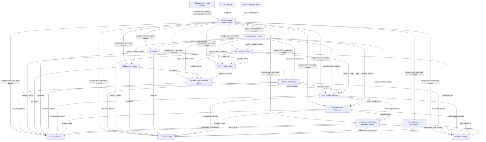

# Kaam Karo — Implementation Plan for a Multi-Agent Build

> **Source of truth:** `Kaam_Karo_Product_Blueprint_v0_4_AI_Voice_Language_Device_Integration.docx` ("the Blueprint", cited as `BP §n`).
> **Architecture:** `architecture.md` (cited as `ARCH §n`). Read it before this file.
> **Purpose:** split the build across specialised AI agents, make every agent aware of what the others will do, are doing and have done, and run a continuous bug-find/bug-fix loop. Everything stays tied to the Blueprint so no agent invents behaviour.

---

## 0. Golden rules (every agent, every task, no exceptions)

These follow the Blueprint's own AI build protocol (BP §43, rules 63–72), extended for multi-agent work.

1. **Read before you write.** Before any task, read: `architecture.md` §0 and the sections your task cites, `coordination/AGENT_BOARD.md`, `coordination/TASKS.md`, the handoffs of every task you depend on, and `coordination/DECISIONS.md`. (BP §43 rule 63)
2. **Cite or stop.** Every behaviour you implement must cite a requirement ID (§5 of this file) and a Blueprint section. If no citation exists, do **not** build it. Add it to `coordination/OPEN_QUESTIONS.md`. (BP §43 rules 64, 66)
3. **Never invent business values.** Prices, fees, commission, cancellation windows, quote validity, badge thresholds, ranking weights, media limits, SLAs, RPO/RTO: always config, seeded with `null` or a placeholder and a `TODO(OWNER)` comment. Exception: when the owner has decided a value in `DECISIONS.md` (e.g. commission 0.30 = D-006, warnings before block = 2 = D-014), seed exactly that value and cite the D-number next to it. (BP §42, §54.2; ARCH §0.3)
4. **Never invent vendors.** Only Google Maps Platform is named. Everything else sits behind an interface with a **fake/sandbox implementation** until the owner decides (ARCH §18, §22).
5. **Server is the source of truth** for status, price and permission. No client-side status changes. (BP §15.1, §29)
6. **Stay in your lane.** Only edit paths your agent owns (§2.3). To change another agent's area, open a request in `coordination/handoffs/REQUESTS.md` and let the owner make the change.
7. **Contract-first.** No endpoint or event is consumed until it exists in `contracts/`. Changing a contract follows §3.4.
8. **Small vertical slices; keep the build green.** After every task: build, lint, typecheck and tests pass. (BP §43 rules 67, 72)
9. **Tests for every critical business rule** (state transitions, money, eligibility, permissions, AI guards). (BP §43 rule 68)
10. **No secrets in git.** Use `.env.example` with fake values only. (BP §43 rule 69)
11. **Log every behaviour change** in `coordination/CHANGELOG.md` and update affected docs. (BP §43 rule 70)
12. **Explain risky architectural changes in plain language first**, as an entry in `DECISIONS.md` with status `Proposed`, and wait for approval. (BP §43 rule 65)
13. **Do not build Later/Proposed features** (BP §72, §86; ARCH §22 last paragraph).
14. **"Done" means the Definition of Done in §8 is met**, not "code written".
15. **Use only the accepted stack** (ARCH §17, decision D-001): React Native (Expo dev builds) + TypeScript for both mobile apps, Next.js for admin, NestJS modular monolith, PostgreSQL + PostGIS via Prisma, Redis + BullMQ with a transactional outbox, S3-compatible private storage, FCM, Google Maps Platform, Sentry. Adding a new framework, a second language or a new database needs a `DECISIONS.md` entry approved by the owner. Small, well-known libraries inside this stack are allowed if listed in the handoff.

---

## 1. How the agents connect (overview)



All communication happens through **files in the repository** (§3). No agent relies on memory of a conversation. If it is not written in `coordination/`, it did not happen.

---

## 2. Agent roster

### 2.1 Summary table

| ID | Agent | Owns (modules / ARCH ref) | Main Blueprint sections |
|---|---|---|---|
| A00 | Orchestrator & Spec Keeper | `coordination/`, `docs/`, requirement registry | §43, §44, §47, §48, §72 |
| A01 | Platform & DevOps | Monorepo, CI/CD, envs, secrets, observability, outbox, **M18 Audit & Events**, **M19 Analytics** sink | §29, §31, §32, §34, §35 |
| A02 | Identity & Profiles | **M1 Identity & Access**, **M2 Profiles** | §8, §21, §26, §27 |
| A03 | Catalog & Config | **M4 Catalog**, **M17 Admin Ops & Config** (config tables, cities/zones) | §4, §6, §42, §57.2, §63, §64 |
| A04 | Booking & Quotes | **M9 Booking & Job**, **M10 Quotes & Fare** | §15–§18, §53, §58 |
| A05 | Matching, Availability & Trust | **M3 Verification & Trust**, **M5 Availability**, **M8 Matching** | §22, §54, §55, §59, §61, §68 |
| A06 | Location & Maps | **M6 Location** | §21, §57, §81 |
| A07 | AI Intake & Voice | **M7 Request & AI Intake**, voice assistant backend | §56, §67, §77, §79 |
| A08 | Media | **M14 Media** | §20, §74, §76 |
| A09 | Payments & Settlement | **M11 Payments & Settlement** | §17, §26, §31.2, §41, §49 |
| A10 | Comms, Notifications, Reviews & Support | **M12**, **M13**, **M15**, **M16** | §19, §20, §24, §40, §80, §82 |
| A11 | Customer App | `apps/customer` | §9, §12, §55, §56, §62.1, §76, §77, §79, §85 |
| A12 | Partner App | `apps/partner` | §10, §13, §52.2, §59, §62.2, §85 |
| A13 | Admin Portal | `apps/admin` | §11, §14, §39, §60.3 |
| A14 | Localization & Accessibility | `packages/i18n`, `packages/ui` (tokens, RTL, fonts) | §37, §38, §78 |
| A15 | Security & Privacy Reviewer | Review only; owns `docs/security/` and permission policy | §28–§30, §67, §74, §75 |
| A16 | QA & Test | `tests/e2e`, test plans, release gate | §43 rules 68 & 72, §45, §49 |
| A17 | Bug Hunter & Fixer | `coordination/BUGS.md`, regression tests | §31, §43 rule 72 |

### 2.2 Agent cards

Each card answers: **mission · inputs (reads from) · outputs (gives to) · must never · done when**.

#### A00 — Orchestrator & Spec Keeper
- **Mission:** Turn the Blueprint into the requirement registry (§5), keep `TASKS.md` and `AGENT_BOARD.md` correct, assign tasks in dependency order, approve contract changes, collect owner decisions.
- **Reads:** Blueprint, every handoff, `OPEN_QUESTIONS.md`, `BUGS.md`.
- **Gives:** task assignments, the decision log, phase-gate verdicts.
- **Must never:** write product code; resolve an `[OPEN]` business question without owner input.
- **Done when:** each phase exit condition (BP §44) is verified with evidence links.

#### A01 — Platform & DevOps
- **Mission:** monorepo skeleton, CI (build/lint/typecheck/test), dev/staging/prod separation, secret management, structured logging, Sentry, health checks, backup + **restore test**, transactional outbox + worker, append-only audit library, analytics event sink.
- **Gives:** `packages/platform` (logger, config loader, outbox, audit, idempotency middleware, error envelope), CI pipelines, `.env.example`.
- **Consumes:** stack decision D-001.
- **Must never:** put real keys in the repo; let the app DB role UPDATE/DELETE audit rows.
- **Done when:** a new module can be scaffolded with logging, audit, outbox and idempotency working out of the box, and a restore test has been run and documented.

#### A02 — Identity & Profiles
- **Mission:** users, roles (customer/provider/admin + 8 admin sub-roles, BP §8.4), sessions with expiry and revocation, **phone OTP login** for customers and providers (D-002 accepted) through `AuthProvider` + `OtpSender` interfaces with a fake sender until the SMS vendor is chosen, OTP send/verify/resend rate limits, Pakistani mobile number validation, admin MFA, blocked accounts, deletion lifecycle, customer/provider profiles, addresses with **snapshot copy**, favorites.
- **Gives:** `requireRole()` / `requirePermission()` guards, `contracts/identity.yaml`, `contracts/profiles.yaml`.
- **Must never:** store raw passwords; expose admin routes on the public auth path.
- **Done when:** the permission matrix (§5, IDs `SEC-AUTH-*` and `ADMIN-ROLE-*`) is fully covered by tests.

#### A03 — Catalog & Config
- **Mission:** category tree + services seeded from **BP §63** (all items, `active = false`), then mark the **BP §6 launch families** as candidates for the launch city. Service config fields per ARCH §5.5 and §19. Generic `ConfigRule` store with scopes (global/city/category/service) and audit on change. City list (Pakistan) with `is_listed` / `is_active`.
- **Gives:** `CatalogService`, `ConfigService.get(key, scope)`, `contracts/catalog.yaml`.
- **Must never:** add services outside the BP §63 list or in the excluded categories (BP §1.4); hard-code a value that BP §42 says is configurable.
- **Done when:** a service can be activated per city without an app release (BP §64), and the seed file has a line-by-line reference to BP §63.

#### A04 — Booking & Quotes
- **Mission:** Booking state machine exactly as ARCH §6.1 (BP §15) with a transition table and guards; Job Events; cancellation/no-show rules (BP §16) using config; quotes (validity, line items, inclusions/exclusions, duration); multi-supplier offers (BP §53); fare lines with `Proposed → Approved/Rejected → Final` (BP §58.2); emergency exception behind a disabled feature flag (K-10).
- **Gives:** `BookingService.requestTransition()`, `QuoteService`, events `booking.*`, `quote.*`, `charge.*`.
- **Consumes:** Catalog (A03), Match Candidates (A05), identity guards (A02), outbox (A01).
- **Must never:** let any caller set status directly; let a provider make a `Proposed` charge payable.
- **Done when:** every row of the transition table has a passing allowed test, and representative illegal transitions have passing **rejection** tests.

#### A05 — Matching, Availability & Trust
- **Mission:** availability rules (weekly hours, breaks, date overrides, emergency flag, capacity, live status, BP §59); service areas/radius; verification levels and records (BP §22); badge engine computed from configured rules (BP §55.2); **low-rating enforcement job (ARCH §6.7, D-014): warnings → block, dry-run until D-017 numbers exist**; matching pipeline (ARCH §9) where the **customer chooses** and nothing is auto-assigned (D-005): hard filters 73–79 → configurable scoring → fairness → explanations; saves Match Candidates with `ranking_version`; supply-gap result (BP §61.3); dual-sided health metrics (BP §61).
- **Gives:** `MatchingService.match(requestId)`, `contracts/matching.yaml`, badge + reason strings (i18n keys, not raw text).
- **Consumes:** Location (A06), Catalog/Config (A03), confirmed requests (A07).
- **Must never:** hard-code weights; let a paid/promoted flag bypass eligibility (BP §68); show "Customer Favorite" (platform badge) and "Favorite" (user action) as the same thing (BP §55.2).
- **Done when:** each hard rule 73–79 has a test that excludes a provider failing only that rule, and changing a weight in config changes the ranking without a deploy.

#### A06 — Location & Maps
- **Mission:** `GeoService` wrapping Google Maps Platform (geocode, reverse geocode, Places autocomplete, distance/ETA via Routes) with restricted keys, quotas, usage metrics and budget alerts; Pakistan boundary check; Location Snapshot creation; straight-line fallback when Routes fails.
- **Gives:** `contracts/location.yaml`, `GeoService`.
- **Must never:** call Maps from the client with an unrestricted key; collect background location (BP §57.4, §81).
- **Done when:** the fallback path is tested with Maps disabled, and usage metrics show in monitoring.

#### A07 — AI Intake & Voice
- **Mission:** `IntakeAI` interface (ARCH §10.4) with a **deterministic fake** (keyword map) plus a real provider adapter after D-009; closed output schema; catalog-ID validation; confidence threshold from config; clarification loop; time/location hint parsing; supplier-ready summary in the app locale; AI Interaction logging with model version; moderation hook; voice command parser returning **intents only** (navigate, search, draft edit, preference filters, read-out, explain, support draft).
- **Gives:** `contracts/intake.yaml`, `contracts/voice.yaml`, the request state machine (ARCH §6.2).
- **Consumes:** Catalog (A03), transcripts (A08), Location hints (A06).
- **Must never:** create a booking, accept a quote, pay, cancel or submit a complaint (BP §77.3); output price fields; return a `serviceId` not in the catalog.
- **Done when:** the Blueprint examples ("Mera AC thanda nahi kar raha", "Kal shaam electrician chahiye", "Mera geyser leak kar raha hai, DHA Phase 4 mein hoon, aaj 7 baje ke baad…") pass as golden tests on the fake and on the real adapter, and an AI outage still lets the user finish manually.

#### A08 — Media
- **Mission:** upload sessions with signed URLs; validation of type/size/duration (limits from config, K-11); thumbnails; optional transcripts through a `SpeechToText` interface; retention jobs; attachment scanning hook; private storage.
- **Gives:** `contracts/media.yaml`, `MediaObject` refs.
- **Must never:** make files public; keep originals forever by default (BP §76.1, §76.3).
- **Done when:** an oversize 30-second clip is rejected, a failed upload leaves the draft intact, and retention deletes expired originals.

#### A09 — Payments & Settlement
- **Mission:** `PaymentGateway` + `PayoutProvider` interfaces with sandbox fakes; cash payment state; idempotent initiation; payment/refund/settlement records that are **immutable** (corrections are reversal rows); reconciliation job; payment only after the booking is `Completed` (D-003); commission split from config `commission.rate = 0.30` → platform 30% / provider 70% (D-006), commission charged **only on Labor / Service fee lines** (D-015, config `commission.base_line_types = ["LABOR"]`); provider earnings ledger where the provider records CASH/DIGITAL at billing and cash jobs **debit 30% of labour from the provider's account** (D-016, ARCH §6.8); unpaid commission (balance < 0) blocks new hiring until the worker pays the company (D-020, task T6.7); worker pays via any bank/wallet, Finance verifies, and already-accepted jobs cannot start while unpaid (D-021); per-party fee visibility (BP §17).
- **Gives:** `contracts/payments.yaml`, events `payment.*`, `refund.*`, `settlement.*`.
- **Must never:** handle raw card data; edit a financial row in place; mark paid before gateway confirmation.
- **Done when:** happy path + failure + refund scenarios are tested (BP §44 phase 6 exit), and double-submit creates exactly one payment.

#### A10 — Comms, Notifications, Reviews & Support
- **Mission:** outbox consumers → per-role notification fan-out (ARCH §7) with templates (localized), priorities and user categories; in-app chat bound to booking participants; attachment limits; `CallRelay` interface (fake); WhatsApp/share **payload builders** (text + deep link; no data reading); reviews only for eligible completed jobs, 1–5 + tags, provider response, flag/report, moderation queue; support tickets with L1–L5 levels; disputes linked to bookings and refunds.
- **Gives:** `contracts/notifications.yaml`, `contracts/chat.yaml`, `contracts/reviews.yaml`, `contracts/support.yaml`.
- **Must never:** put raw phone numbers in chat payloads by default (BP §20); allow a review without a completed eligible booking (BP §19).
- **Done when:** each event in ARCH §7 produces the right message for each role in both `en` and `ur`.

#### A11 — Customer App
- **Mission:** screens C01–C42 (ARCH §3.1) in vertical slices; "Talk, show, tap" composer; just-in-time permission prompts with fallbacks; voice overlay (push-to-talk); recorders; system photo picker; location confirm; match results with reasons; offer comparison; charge approval; tracking; reviews; support; language switch; local drafts; pending/unknown states; low-end device performance.
- **Consumes:** contracts only (never backend internals), the UI kit from A14.
- **Must never:** compute prices or statuses locally; request permissions at install/launch; show success before server confirmation.
- **Done when:** the customer journey BP §9 runs end-to-end on a low-cost Android device in both languages.

#### A12 — Partner App
- **Mission:** screens P01–P26 (ARCH §3.2); onboarding + verification upload (document picker); service setup; availability + overrides + status switch; incoming requests showing summary, location, media, commercial model and time window; Accept / Quote / Ask / Decline in one or two taps; quote builder; job execution states; extras/charges (proposed only); completion evidence; earnings and settlement status; navigation hand-off.
- **Must never:** see customer private data before a match (BP §52.2); track location outside an active job.
- **Done when:** the provider journey BP §10 runs end-to-end.

#### A13 — Admin Portal
- **Mission:** A01–A26 (ARCH §3.3) with sub-role permission checks on every page; verification queue; catalog/city activation; config editors (matching weights, badges, fees, windows) that write audited ConfigRules; bookings/quotes/payments exception views; disputes/refunds; moderation; support queue; reports; audit log viewer; marketplace health; AI interaction viewer; system health.
- **Must never:** edit the DB directly; show password or secret fields; let a Support sub-role change financial config (BP §8.4).
- **Done when:** "Admin can run marketplace without direct database edits" (BP §44 phase 5 exit).

#### A14 — Localization & Accessibility
- **Mission:** i18n framework, `en`/`ur` string catalogs, RTL mirroring rules, Urdu font integration (Noto Nastaliq Urdu as candidate, BP §78.2) with line-height tokens, PKR/date formatting, accessibility tokens (contrast, tap size, never colour-only status), a lint rule that fails on hard-coded user-facing strings.
- **Gives:** `packages/i18n`, `packages/ui` primitives used by A11/A12/A13.
- **Done when:** screenshots of every launch screen in `ur` on a small screen pass the RTL/typography checklist (§7.3).

#### A15 — Security & Privacy Reviewer
- **Mission:** review every merge that touches auth, money, PII, permissions, AI or media. Maintain the permission policy (BP §74–§75) and threat checklist (BP §30). Run dependency and secret scans.
- **Gives:** review verdicts in the handoff file (`SEC-REVIEW: PASS | CHANGES-REQUIRED`) and security bugs in `BUGS.md`.
- **Must never:** approve a change that requests contacts, call logs, Bluetooth, calendar or background location (BP §75 item 98).

#### A16 — QA & Test
- **Mission:** test plan per phase; contract tests between producer and consumer; E2E for the three journeys (BP §9–§11); device matrix (low-cost Android, small screen, slow network); release gate (BP §49 checklist).
- **Gives:** test reports linked from handoffs; gate verdicts to A00.

#### A17 — Bug Hunter & Fixer
- **Mission:** continuous bug sweeps (§7), reproduce, write a failing regression test, route to the owner, or fix directly when allowed (§7.2); verify fixes; keep `BUGS.md` honest.
- **Must never:** close a bug without a regression test, or "fix" by weakening a test or a rule.

### 2.3 File ownership map (prevents agents overwriting each other)

| Path | Owner | Others may |
|---|---|---|
| `coordination/**`, `docs/requirements/**` | A00 | Append to their own rows/handoffs only |
| `contracts/<module>.yaml`, `contracts/events/<module>.*.json` | Module owner | Propose changes via §3.4 |
| `packages/platform/**`, `infra/**`, `.github/**` | A01 | Request |
| `services/api/src/modules/identity`, `profiles` | A02 | — |
| `.../modules/catalog`, `config` | A03 | — |
| `.../modules/booking`, `quotes` | A04 | — |
| `.../modules/matching`, `availability`, `trust` | A05 | — |
| `.../modules/location` | A06 | — |
| `.../modules/intake`, `voice` | A07 | — |
| `.../modules/media` | A08 | — |
| `.../modules/payments` | A09 | — |
| `.../modules/notifications`, `chat`, `reviews`, `support` | A10 | — |
| `apps/customer/**` | A11 | — |
| `apps/partner/**` | A12 | — |
| `apps/admin/**` | A13 | — |
| `packages/i18n/**`, `packages/ui/**` | A14 | Add string keys via PR comment |
| `docs/security/**` | A15 | — |
| `tests/e2e/**`, `docs/qa/**` | A16 | Add cases via request |
| Regression tests under `**/__regression__/**` | A17 | — |

---

## 3. Coordination system (how agents know what others will do, are doing and have done)

### 3.1 Repository layout

```
/coordination
  AGENT_BOARD.md        live status of every agent (doing / blocked / next)
  TASKS.md              master task list with owners, deps, status
  DECISIONS.md          owner decisions (D-xxx) + proposed tech decisions
  OPEN_QUESTIONS.md     anything not answerable from the Blueprint
  BUGS.md               bug register (§7)
  CHANGELOG.md          behaviour changes, newest first
  CONFLICTS.md          copy of ARCH §21 + new conflicts found
  handoffs/
    REQUESTS.md         cross-agent change requests
    T-<id>.md           one handoff per finished task
/contracts              OpenAPI per module + event JSON schemas + generated TS types
/docs/requirements/REQUIREMENTS.md   requirement registry (§5)
```

### 3.2 `AGENT_BOARD.md` format (each agent edits only its own row)

```markdown
| Agent | Now doing (task) | Status | Branch | Blocked by | Next planned | Last update (UTC) |
|---|---|---|---|---|---|---|
| A04 | T3.4 Booking transitions | IN_PROGRESS | t3.4-booking-sm | — | T3.5 Quotes | 2026-10-23 09:10 |
| A05 | T3.6 Matching filters | BLOCKED | t3.6-match | T3.2 (GeoService contract) | — | 2026-10-23 09:02 |
```

Status values: `IDLE`, `IN_PROGRESS`, `BLOCKED`, `IN_REVIEW`, `DONE`.

### 3.3 Task lifecycle

```
TODO → CLAIMED → IN_PROGRESS → IN_REVIEW (A15 if sensitive, A16 always) → DONE
                       │
                       └── BLOCKED (must name the blocking task/decision)
```

**Start-of-task checklist** (paste into the task branch description):

```
[ ] Read architecture.md §0 + cited sections
[ ] Read handoffs of all depends_on tasks
[ ] Read DECISIONS.md (any D-xxx affecting me?)
[ ] Read BUGS.md entries assigned to my module
[ ] Confirm all contracts I consume exist and are APPROVED
[ ] Updated my AGENT_BOARD row to IN_PROGRESS
[ ] Listed requirement IDs this task implements: ____
```

**End-of-task handoff** — `coordination/handoffs/T-<id>.md` (mandatory):

```markdown
# Handoff T-<id> — <title>
Agent: A0x            Date: YYYY-MM-DD
Requirement IDs: BOOK-STATUS-001..015
Blueprint refs: §15, §16
## What I built
- …
## Contracts published/changed
- contracts/booking.yaml v1.2 (added POST /bookings/{id}/transitions)
## Events emitted
- booking.accepted (schema contracts/events/booking.accepted.json)
## Config keys introduced (all TODO(OWNER) unless decided)
- booking.cancellation.free_window_minutes = null
## How to use it (for consumer agents)
- Call BookingService.requestTransition(bookingId, "ACCEPT", actor)
## Tests
- 42 unit, 6 API; coverage of transition table 100%
## Known limitations / follow-ups
- Emergency exception disabled (K-10)
## Open questions raised
- OQ-014
## Reviews
- QA: PASS (A16)    SEC-REVIEW: PASS (A15)
```

### 3.4 Contract change protocol

1. The producer agent edits `contracts/<module>.yaml` on a branch and bumps the version (semver: breaking = major).
2. The producer adds a `CONTRACT CHANGE` entry to `REQUESTS.md` listing the consumer agents (from §4).
3. Each consumer replies `ACK` or `CONCERN: …` in the same entry.
4. A00 approves after all ACKs. A **breaking** change also needs a migration note and a deprecation period, or a coordinated merge.
5. Generated TypeScript types are regenerated in CI, so a consumer compiling against an old contract fails fast.

### 3.5 Cross-agent request format (`REQUESTS.md`)

```markdown
## RQ-031  FROM A11 → TO A04   (status: OPEN)
Need: booking response to include `allowedNextActions[]` so the app never guesses buttons.
Why: BP §15.1 (server is source of truth), BP §62.2
Blocking: T3.10
Reply: …
```

### 3.6 Daily sync rule (for long-running sessions)

At the start of each work session, every agent: (1) re-reads `AGENT_BOARD.md`, `REQUESTS.md` and new handoffs since its last update; (2) answers any request addressed to it before starting new work; (3) updates its board row. A00 posts a short `## Sync YYYY-MM-DD` note at the top of `AGENT_BOARD.md` with blockers and re-ordering.

---

## 4. Dependency map (who needs what from whom)

| Consumer → | needs from producer | Item |
|---|---|---|
| everyone | A01 | repo, CI, config loader, logger, outbox, audit, idempotency |
| A03, A04, A05, A09, A10, A13 | A02 | auth guards, roles, user IDs |
| A04, A05, A07, A11, A12, A13 | A03 | catalog + `ConfigService` |
| A05, A07, A11, A12 | A06 | `GeoService`, Location Snapshot |
| A07, A11, A12, A10 | A08 | media upload + refs + transcripts |
| A05 | A07 | confirmed Customer Request |
| A04, A11 | A05 | Match Candidates + reasons + supply-gap result |
| A09, A10, A11, A12, A13 | A04 | booking/quote/charge contracts + events |
| A10, A11, A12, A13 | A09 | payment/settlement contracts + events |
| A11, A12, A13 | A10 | notification, chat, review, support contracts |
| A11, A12, A13 | A14 | i18n + UI kit + RTL rules |
| A00 | A15, A16 | review and gate verdicts |
| owners | A17 | bug reports with failing tests |

---

## 5. Requirement registry (seed)

Format per BP §48: `AREA-TOPIC-NNN`. A00 expands this into `docs/requirements/REQUIREMENTS.md`, adding acceptance criteria. **Agents must not create requirement IDs themselves.** They ask A00.

| ID range | Requirement (short) | BP | Owner |
|---|---|---|---|
| SCOPE-GEO-001 | Pakistan-only marketplace; city listed ≠ active | §57.2, §69 | A03 |
| SCOPE-GEO-002 | Launch city = Lahore (only active city); the whole of Lahore is active from the pilot | §6.2; D-007, D-019 | A03 |
| SCOPE-CAT-001 | Catalog limited to BP §63 tree; excluded categories never present | §1.4, §63 | A03 |
| SCOPE-CAT-002 | Active launch set per city configurable; day one in Lahore = all 10 families from §6 (D-024) | §6, §64; D-024 | A03 |
| CAT-SVC-001..010 | Service config: price model, selling modes, inspection/quote flags, emergency allowed, verification required, customer questions, AI guidance, inclusions/exclusions, pricing unit, materials/warranty policy | §4.2, §53, §64 | A03 |
| CFG-RULE-001..012 | Every BP §42 rule stored as audited config | §42 | A03 |
| SEC-AUTH-001..008 | Phone OTP login via `AuthProvider`/`OtpSender` (D-002 accepted; no passwords for customers/providers); sessions expire/revoke; no raw passwords; OTP rate-limit; admin MFA; blocked accounts; recovery abuse protection; deletion lifecycle | §27, §29 | A02 |
| ADMIN-ROLE-001..008 | Eight admin sub-roles with least privilege | §8.4 | A02/A13 |
| PROF-ADDR-001..004 | Multiple labelled addresses; snapshot copied to booking; manual entry when location denied; provider sees only needed location | §21 | A02/A06 |
| LOC-GEO-001..008 | JIT permission; suggest-not-lock city; map pin/search/saved/manual; reverse geocode; distance/ETA; fallback; no background location; key restriction + budgets | §57, §74, §81 | A06 |
| REQ-AI-001..012 | Intent, service mapping, minimal clarification, time & location hints, summary, confidence fallback, catalog-ID validation, version logging, moderation, no prices, no diagnosis claims, non-fatal failure | §56, §67 | A07 |
| VOICE-001..008 | Push-to-talk; listening state; show recognized text; undo/cancel; text fallback; en/ur; confirmation before consequential actions; intent-only actions | §77 | A07/A11 |
| MEDIA-001..009 | Audio ≈2 min; video ≈30 s 720p-class; on-device compression; size limit + duration limit; thumbnail; transcript; retention; system pickers; draft survives upload failure | §76 | A08/A11 |
| MATCH-ELIG-073..079 | Hard eligibility rules exactly as BP §54.1 items 73–79 | §54.1 | A05 |
| MATCH-SCORE-001..013 | Each BP §54.2 signal, weights from config, ranking_version stored | §54.2, §66 | A05 |
| MATCH-FAIR-001..004 | New-provider exposure; anti-monopoly; paid placement cannot defeat eligibility; overrides audited | §54.2, §68 | A05 |
| MATCH-EXPL-001 | "Why am I seeing this?" reasons | §54.3 | A05/A11 |
| MATCH-MODE-001 | Customer chooses the supplier or offer; no auto-assign | §46, §53; D-005 | A05/A11 |
| PROV-CREW-001..006 | Crew size required on offer/quote; copied to booking; shown to customer before choosing and on booking screens; change after acceptance needs customer approval; **crew size never used in price calculation** (price depends on the nature of the work); **only the team leader (provider account holder) is verified**, no team-member accounts at launch | §4.1, §18, §22, §58; D-004, D-018 | A04/A05/A11/A12 |
| RATING-ENF-001..008 | Rating per completed job; only eligible ratings count; warning 1, warning 2 (count from config, seeded 2); block with reason LOW_RATING; blocked provider excluded from matching; admin reinstate audited; notifications en/ur; dry-run until D-017 thresholds set | §19, §54.1 rule 73, §8.3; D-014, D-017 | A05/A10/A13 |
| MATCH-GAP-001 | Supply-gap options instead of empty screen | §61.3 | A05/A11 |
| AVAIL-001..007 | Weekly hours, breaks, date overrides, emergency flag, radius/zones, capacity, 5 live statuses | §59 | A05 |
| TRUST-VER-001..004 | Four verification levels; risk-proportional requirements per category | §22 | A05 |
| TRUST-BADGE-001..014 | Each badge from §55.2 computed from a configured rule; Favorite ≠ Customer Favorite | §55.2 | A05 |
| BOOK-STATUS-001..015 | One status per Booking state in BP §15; transition table; events recorded; server-only | §15 | A04 |
| BOOK-CANCEL-001..006 | Six cancellation/no-show situations in BP §16 | §16 | A04 |
| PRICE-001..007 | Seven pricing rules in BP §17 | §17 | A04/A09 |
| QUOTE-001..008 | Quote steps BP §18 items 55–62 + multi-supplier offers | §18, §53 | A04 |
| FARE-001..011 | Eleven fare line types BP §58.1; proposed/approved/rejected/final; emergency exception flag | §58 | A04 |
| PAY-001..008 | Cash + digital design; idempotent initiation; immutable records; reversals; reconciliation; refunds; settlements; no raw card data | §17, §26, §29, §31 | A09 |
| PAY-TIMING-001 | Payment can only be initiated after booking status `Completed` | D-003 | A09/A04 |
| COMM-001..004 | Commission rate from config (0.30); provider share of labour = 70%; commission base = Labor / Service fee lines only; split shown to each party per BP §17 | §17, §41, §58.1; D-006, D-015 | A09 |
| LEDGER-001..007 | Provider records CASH/DIGITAL at billing; CASH only if no confirmed digital payment; cash → debit 30% of labour; digital → credit bill − commission; append-only rows + reversals; balance + history visible in P15 and admin A09; payout of positive balance via Settlement | §13 P15, §26; D-016 | A09/A12/A13 |
| LEDGER-NEG-001..006 | Balance below 0 (config `ledger.max_negative_balance` = 0) → excluded from matching, cannot accept/quote/be rebooked from Favorites; Partner App shows amount owed + "Pay company"; eligibility returns automatically when balance ≥ 0; not a suspension; already-accepted jobs cannot **start** (En Route / In Progress refused with `UNPAID_COMMISSION`) until paid (D-021); unpaid at appointment time → treated as provider cancellation per BP §16 after a config grace time (`[INTERPRETATION]`, D-022) | ARCH §6.8, §9, BP §16; D-020, D-021 | A09/A05/A04/A12 |
| LEDGER-PAY-001..007 | "Pay company" shows amount owed + company account details (config); worker pays via any bank or mobile wallet, then submits transaction ID + optional screenshot (system photo picker); Finance verification queue in admin A09; approve/reject with reason, audited; approval writes a credit ledger row; only Finance-approved or gateway-confirmed credits clear the block; events submitted/rejected/cleared | ARCH §6.8, §7, BP §26, §75; D-021 | A09/A12/A13/A10 |
| REV-001..007 | Seven review rules BP §19 | §19 | A10 |
| CHAT-001..004 | In-app chat; masked/relay calling; attachment limits & scanning; phone/WhatsApp as intents only | §20, §74, §82 | A10 |
| NOTIF-001..010 | Each event in ARCH §7 per role; user categories; priority; contextual permission | §24, §80 | A10 |
| SUP-001..005 | Tickets; L1–L5 escalation; disputes; dispute→refund link; structured complaint flow | §40, §12 C29 | A10 |
| I18N-001..008 | en/ur; switch anytime; RTL mirroring; Urdu font & line height; no careless mixed labels; strings outside code; PKR/date format; low-end device tests | §37, §78 | A14 |
| A11Y-001..008 | Eight accessibility rules BP §38 | §38 | A14 |
| REL-001..013 | App (6) and backend (7) resilience rules BP §31.1–§31.2 | §31 | A01 + all |
| SEC-BASE-001..012 | Security baseline BP §29 | §29 | A15 + all |
| PERM-001..006 | Just-in-time permission items BP §75 items 93–98 | §75 | A15/A11/A12 |
| ABUSE-001..010 | Ten risks in BP §30 table | §30 | A15 + owners |
| OPS-ADMIN-001..020 | Admin screens A01–A20 (+A21–A26 derived) | §14, §39 | A13 |
| HEALTH-001..020 | Customer-side and supplier-side health metrics | §61 | A05/A13 |
| ANALYTICS-001..008 | Metric groups BP §35 | §35 | A01/A13 |

---

## 6. Phased plan (follows BP §44, extended for v0.3/v0.4)

Each task line: **ID · title · owner · depends on · deliverable · acceptance (must be testable) · BP refs**.
A00 copies these into `TASKS.md`. A phase is closed only when its **exit condition** is proven by A16 and recorded by A00.

### Phase 0 — Discovery & decisions (BP §44 phase 0)
Exit: no major unresolved product ambiguity for MVP.

| ID | Task | Owner | Deps | Acceptance | BP |
|---|---|---|---|---|---|
| T0.1 | Create `coordination/` files and templates from §3 | A00 | — | All files exist with templates | §43 |
| T0.2 | Build the requirement registry from §5 with acceptance criteria | A00 | T0.1 | Every Blueprint section §1–§87 maps to ≥1 ID or is marked "informational" | §47, §48 |
| T0.3 | Copy ARCH §21 conflicts and §22 decisions into `CONFLICTS.md` / `DECISIONS.md` (record D-001, D-002, D-003, D-005, D-006, D-007, D-014 as Accepted 2026-10-22); record D-004, D-015, D-016, D-018, D-019 and the D-017 threshold as Accepted too; record D-020 and D-021 Accepted too; ask the owner the rest of D-017 and D-022 | A00 | T0.1 | Each decision has status Proposed/Accepted | §46, §72 |
| T0.4 | Permission & threat policy v1 | A15 | T0.1 | Matches BP §28, §74, §75 tables exactly | §28–§30, §74, §75 |
| T0.5 | Test strategy + device matrix | A16 | T0.2 | Includes low-cost Android, small screen, slow network, Urdu | §38, §49, §78.2 |
| T0.6 | **Urdu Nastaliq smoke test** (condition of D-001): one Expo dev-build screen with Noto Nastaliq Urdu, RTL layout, mixed Urdu/English label, a list, a bottom sheet and a text input, run on the cheapest phone in the device matrix (D-027: cheapest, lowest-spec Android phone) | A14 + A01 | T0.5 | Screenshots in `docs/qa/urdu-smoke/`: no clipped marks, readable line height, correct RTL mirroring, smooth scroll. On FAIL, A00 reopens D-001 | §78.2 |

**Gate G0:** ✅ D-001 (stack) accepted on 2026-10-22 (ARCH §17). Coding may start once T0.1–T0.3 are done. T0.6 must pass before Phase 3 UI work begins.

### Phase 1 — UX foundation (BP §44 phase 1)
Exit: all launch screens mapped.

| ID | Task | Owner | Deps | Acceptance | BP |
|---|---|---|---|---|---|
| T1.1 | Screen specs for C01–C42 (fields, states: loading/empty/success/error/pending) | A11 + A00 | T0.2 | Every screen has all 5 states defined | §12, §45 |
| T1.2 | Screen specs for P01–P26 | A12 + A00 | T0.2 | Same | §13 |
| T1.3 | Screen specs for A01–A26 with sub-role access per screen | A13 + A00 | T0.2 | Access matrix complete | §14, §8.4 |
| T1.4 | i18n + RTL + Urdu typography kit; string-lint rule | A14 | G0 | Sample screen renders correctly in `ur` on a small device | §78 |
| T1.5 | Flow maps: request → match → book/quote → job → pay → review; supply gap; dispute | A00 | T1.1–T1.3 | Each arrow cites a state transition from ARCH §6 | §9–§11, §15 |

### Phase 2 — Backend foundation (BP §44 phase 2)
Exit: secure login and data model working.

| ID | Task | Owner | Deps | Acceptance | BP |
|---|---|---|---|---|---|
| T2.1 | Monorepo, CI (build/lint/typecheck/test), envs, secrets, Sentry, health check | A01 | G0 | CI green on an empty module; no secret in repo (scanner) | §29, §34 |
| T2.2 | Platform lib: config loader, error envelope, idempotency middleware, outbox + worker, append-only audit | A01 | T2.1 | Idempotency test: same key twice → one row; audit UPDATE denied at DB level | §26, §31.2 |
| T2.3 | DB schema v1 for all ARCH §5 entities (technical fields per ARCH §5) + migrations | A01 with each owner | T2.1 | Every table/column has a comment citing BP § | §25, §66 |
| T2.4 | Identity: phone OTP login (D-002) with fake `OtpSender`, OTP expiry + attempt limits + resend cooldown (values in config, `TODO(OWNER)`), sessions, roles, admin sub-roles, MFA for admin | A02 | T2.2 | SEC-AUTH-* and ADMIN-ROLE-* tests pass; brute-forcing an OTP is blocked by the attempt limit (test); no password column for customers/providers | §8, §27, §29 |
| T2.5 | Profiles + addresses + snapshot helper + favorites | A02 | T2.4 | Editing an address does not change an existing booking snapshot | §21, §26 |
| T2.6 | Catalog seed from BP §63 (all inactive) + launch-family flags + `ConfigRule` store + cities: **Lahore** `is_listed = true, is_active = true` (D-007); other Pakistani cities `is_listed = true, is_active = false`; whole Lahore seeded as one active service zone (D-019); provider radius/areas still work inside it (BP §59); the 10 day-one families of D-024 active in Lahore | A03 | T2.3 | Seed count equals BP §63 items; excluded categories absent; only Lahore is active; exactly the 10 D-024 families are active in Lahore | §6, §42, §57.2, §63, §64 |
| T2.7 | Backup + **restore test** in staging | A01 | T2.3 | Restore documented with timestamp | §31.3, §49 |
| T2.8 | Security review of T2.1–T2.6 | A15 | T2.4–T2.6 | SEC-REVIEW PASS | §29 |

### Phase 3 — Customer MVP incl. smart request (BP §44 phase 3 + v0.3/v0.4)
Exit: customer can request a real job.

| ID | Task | Owner | Deps | Acceptance | BP |
|---|---|---|---|---|---|
| T3.1 | `GeoService` + Pakistan boundary + Location Snapshot + fallback | A06 | T2.3 | Works with Maps disabled (fallback test) | §57, §81 |
| T3.2 | Media upload sessions, limits from config, thumbnails, retention job | A08 | T2.2 | Oversize/overlong media rejected; draft survives failure | §76 |
| T3.3 | `IntakeAI` fake + closed schema + catalog validation + confidence fallback + AI logs | A07 | T2.6 | Golden tests on the Blueprint examples | §56, §67 |
| T3.4 | Booking state machine + Job Events + cancellation rules (config) | A04 | T2.6 | 100% transition table coverage | §15, §16 |
| T3.5 | Quotes + multi-supplier offers + fare lines (proposed/approved/rejected/final) + **crew size** (ARCH §5.6) | A04 | T3.4 | Unapproved line never payable (test); offer without crew size rejected (test); crew-size change after acceptance creates an approval request (test) | §18, §53, §58; D-004 |
| T3.6 | Availability, service areas, verification levels | A05 | T2.5 | AVAIL-* and TRUST-VER-* tests pass | §22, §59 |
| T3.7 | Matching: hard filters 73–79, configurable scoring, fairness, reasons, ranking_version, supply gap | A05 | T3.1, T3.3, T3.6 | One test per hard rule; weight change → ranking change without deploy; no code path assigns a provider without the customer's choice (D-005) | §54, §61.3, §68; D-005 |
| T3.8 | Customer app: onboarding, language choice, login, home, search, category, service detail, provider profile | A11 | T2.4, T2.6, T1.4 | C01–C11 + C41 in en/ur | §12, §78 |
| T3.9 | Customer app: "What do you need?" composer, audio/video recorders, photo picker, location confirm, summary confirm | A11 | T3.1–T3.3 | Permissions only requested on tap; every input has a fallback | §75, §76, §79 |
| T3.10 | Customer app: match results, comparison, reasons, offers comparison, booking review/confirmation, supply-gap screen | A11 | T3.5, T3.7 | Buttons driven by server `allowedNextActions` | §55, §61.3 |
| T3.11 | Voice assistant v1 (push-to-talk, intents only, confirmation dialogs) | A07 + A11 | T3.3, T3.9 | Booking/quote/pay/cancel via voice always shows a confirm step | §77 |
| T3.12 | QA: customer journey E2E (BP §9 steps up to "Confirm request/booking") | A16 | T3.8–T3.11 | Passes on the device matrix in en and ur | §9 |

### Phase 4 — Provider MVP (BP §44 phase 4)
Exit: provider can accept and complete a real job.

| ID | Task | Owner | Deps | Acceptance | BP |
|---|---|---|---|---|---|
| T4.1 | Partner onboarding + verification upload (document picker) | A12 | T2.4, T3.6 | P01–P03 | §10, §22 |
| T4.2 | Service setup, availability, overrides, status switch, service area | A12 | T3.6 | P05–P07, P22, P23 | §59 |
| T4.3 | Incoming requests + job detail with media player; Accept/Quote/Ask/Decline ≤ 2 taps | A12 | T3.5, T3.7, T3.2 | No customer PII shown pre-match (test) | §52.2, §62.2, §85 |
| T4.4 | Quote builder with BP §58.1 line types + crew size; crew size also asked on Accept for instant bookings | A12 | T3.5 | Validity + inclusions/exclusions + crew size required | §18, §58; D-004 |
| T4.5 | Job execution: en route, arrived, in progress, extras (proposed), completion evidence, navigation hand-off | A12 + A06 | T3.4 | Location only shared during active job, indicator visible | §57.4, §81 |
| T4.6 | Customer side of execution: tracking, charge approval sheet, completion confirm | A11 | T4.5 | C17, C19, C20, C37 | §9, §58.2 |
| T4.7 | QA: provider journey E2E (BP §10) + joint customer/provider E2E | A16 | T4.1–T4.6 | Passes | §10 |

### Phase 5 — Admin MVP (BP §44 phase 5)
Exit: admin can run the marketplace without direct database edits.

| ID | Task | Owner | Deps | Acceptance | BP |
|---|---|---|---|---|---|
| T5.1 | Admin auth (separate path, MFA) + sub-role guards | A13 + A02 | T2.4 | Support role cannot open Fees page (test) | §8.4, §27 |
| T5.2 | Users, provider verification queue, categories/services, city activation | A13 | T2.6, T3.6 | A03–A06, A23 | §14, §57.2 |
| T5.3 | Bookings, quotes exceptions, matching weights, badge rules, AI guidance editor | A13 | T3.5, T3.7 | Config edits audited | §54.2, §64 |
| T5.4 | Audit log viewer, reports, marketplace health, AI interaction viewer, system health | A13 + A01 | T2.2 | A16, A17, A19, A25, A26 | §61, §66, §67 |

### Phase 6 — Payments (BP §44 phase 6)
Exit: happy path + failure/refund scenarios tested.

| ID | Task | Owner | Deps | Acceptance | BP |
|---|---|---|---|---|---|
| T6.1 | Payment state model: cash + digital (fake gateway), idempotent initiation, **payment allowed only after `Completed`** (D-003) | A09 | T3.4 | Double tap → one payment; payment attempt before Completed → rejected (test) | §17, §31; D-003 |
| T6.2 | Commission split from config `commission.rate = 0.30` (D-006) on labour lines only (D-015), per-party fee display data | A09 + A03 | T6.1 | ARCH §6.8 worked example as a test: labour 2,000 + parts 1,500 + visit 300 → commission 600, provider share 3,200; parts/visit never commissioned; no literal 0.30 outside the config seed (grep test); rounding rule documented | §17, §41, §42, §58.1; D-006, D-015 |
| T6.6 | Provider earnings ledger (ARCH §6.8): "How was it paid?" CASH/DIGITAL at billing (P14/P15), cash → debit 30% of labour, digital → credit bill − commission, history in P15 and admin A09, "Paid by" shown on C20 | A09 + A12 + A13 + A11 | T6.2 | Cash example → debit 600; digital example → credit 3,200; provider cannot record CASH when a confirmed digital payment exists (test); ledger rows never updated (DB grant test); negative balance allowed and shown | §13, §26; D-016 |
| T6.7 | Unpaid-commission hiring block (ARCH §6.8, D-020): extra hard filter in matching, guards on accept/quote/favorite-rebook, guards on starting already-accepted jobs (D-021), "Pay company" screen in P15 (transaction ID + screenshot), Finance verification queue in admin A09, auto-unblock on balance ≥ 0, events `provider.balance_negative` / `provider.commission_payment_submitted` / `provider.commission_payment_rejected` / `provider.balance_cleared` | A09 + A05 + A04 + A12 + A13 | T6.6, T3.7 | Tests: after a cash job with Rs. 600 owed, the provider is absent from matching and accept/quote returns 409 `UNPAID_COMMISSION`; after a Rs. 600 payment the provider appears again; a job accepted earlier cannot move to En Route while Rs. 600 is owed; a submitted-but-unverified payment does **not** unblock; a Finance-approved payment does; no literal 0 limit outside config | ARCH §6.8, §9; D-020 |
| T6.3 | Refunds (reversal rows), settlements, reconciliation job | A09 | T6.1 | Financial rows never updated in place (DB grant test) | §26 |
| T6.4 | Payment UI: C16, C24, P15, P16; admin A09, A10, A13 | A11, A12, A13 | T6.1–T6.3 | Pending/unknown state shown on network loss | §31.1 |
| T6.5 | Real gateway adapter (after D-008) | A09 | D-008 | Sandbox certification passed | §33 |

### Phase 7 — Trust, notifications, communication (BP §44 phase 7)
Exit: operational flows complete.

| ID | Task | Owner | Deps | Acceptance | BP |
|---|---|---|---|---|---|
| T7.1 | Notification fan-out for every ARCH §7 event, en/ur templates, categories, priority, contextual permission | A10 + A11/A12 | T2.2 | NOTIF-* pass | §24, §80 |
| T7.2 | Chat bound to booking, attachment limits/scanning, `CallRelay` fake, share payloads (WhatsApp via ACTION_SEND) | A10 + A11/A12 | T3.4 | No raw phone numbers in payloads | §20, §82 |
| T7.3 | Reviews (eligible only), provider response, flag/report, moderation queue | A10 + A13 | T3.4 | REV-* pass | §19 |
| T7.4 | Badges computed from configured rules + display | A05 + A11 | T7.3 | Each badge traceable to its rule | §55.2 |
| T7.6 | Low-rating enforcement (ARCH §6.7): scheduled job, warning 1 → warning 2 → block, notifications, admin reinstate with reason, dry-run mode | A05 + A10 + A13 + A12 | T7.3, T5.1 | Tests: provider below threshold gets warning 1, then warning 2, then blocked; recovery above threshold resets; blocked provider never appears in matching; moderated-out reviews ignored; threshold read from config (seeded 2.0): average 1.99 triggers, exactly 2.0 does not; while minimum ratings or review period are `null` the job only logs ("dry run") and blocks nobody | §19, §54.1, §8.3; D-014, D-017 |
| T7.5 | Support tickets L1–L5, disputes ↔ refunds, C28/C29, P20, A10/A12 | A10 + apps | T6.3 | Dispute outcome recorded per ARCH §6.1 note | §40 |

### Phase 8 — QA & hardening (BP §44 phase 8)
Exit: release gate passed.

| ID | Task | Owner | Deps | Acceptance | BP |
|---|---|---|---|---|---|
| T8.1 | Full bug sweep (§7.3 checklist) across all modules | A17 | all above | 0 open S1/S2 | §31 |
| T8.2 | Security review + abuse scenarios BP §30 | A15 | all above | All ten risks have a test or control | §29, §30 |
| T8.3 | Performance budgets for AI/map/media/notifications (values from D-012) | A01 + A16 | D-012 | Budgets measured on low-end device | §62, §84 item 120 |
| T8.4 | Accessibility + Urdu RTL audit of every screen | A14 + A16 | all UI | Checklist §7.3-E passes | §38, §78 |
| T8.5 | Restore drill + incident owner named | A01 | T2.7 | Drill log | §31.3 |

### Phase 9 — Pilot / Phase 10 — Public launch (BP §44, §49)

A00 runs the **minimum launch checklist** (BP §49) item by item, with evidence links. Items that depend on the business (city selected, providers recruited, support team trained, store assets, privacy policy/terms) are **owner tasks**, not agent tasks. Agents only report their status.

---

## 7. Bug-finding and bug-fixing loop

### 7.1 Bug record format (`coordination/BUGS.md`)

```markdown
## BUG-0042  [S2]  status: OPEN  owner: A04  found by: A17  phase: 3
Title: Customer can cancel a booking that is already In Progress without a fee
Requirement violated: BOOK-CANCEL-002   Blueprint: §16
Repro:
 1. Create booking → Accepted → Scheduled → En Route → Arrived → In Progress
 2. POST /bookings/{id}/transitions {to: CANCELLED} as customer
Expected: 409 + reason TRANSITION_NOT_ALLOWED (§15 table: In Progress → Awaiting Approval/Completed/Disputed only)
Actual: 200, status = Cancelled
Failing test: services/api/src/modules/booking/__regression__/BUG-0042.spec.ts
Fix PR: —      Verified by: —
```

Severity:

| Sev | Meaning | Examples | Fix deadline |
|---|---|---|---|
| S1 | Money, security, data loss/corruption, privacy leak, crash on a core path | Duplicate payment; customer PII shown pre-match; status set by client | Stop the line; fix before any other work in that module |
| S2 | Core journey broken or a Blueprint rule violated | Illegal transition allowed; permission asked at launch | Within the current task cycle |
| S3 | Wrong but with a workaround | Wrong badge text; RTL arrow not mirrored | Before the phase gate |
| S4 | Cosmetic | Spacing | Backlog |

### 7.2 Who fixes what

1. **A17 finds** (sweep, test failure, review, QA report) → reproduces → writes a **failing regression test** → records it in `BUGS.md` → assigns the **module owner**.
2. The **owner fixes** (default). The fix must make the regression test pass without editing the test's expectation, unless A00 confirms the expectation was wrong against the Blueprint.
3. A17 may fix **directly** only when: severity is S3/S4, **or** the owner is `IDLE` for over one work session on an S1/S2. In that case A17 writes a handoff to the owner explaining the change.
4. **A16 verifies** (re-runs regression + related suites) → A17 sets `VERIFIED` → A00 marks it `CLOSED`.
5. If a fix changes behaviour, log it in `CHANGELOG.md`. If it changes a contract, use §3.4.
6. **Root-cause note** is mandatory for S1/S2: which rule was missing (test gap, contract gap, spec gap). A spec gap goes to `OPEN_QUESTIONS.md`.

**Forbidden "fixes":** deleting or skipping tests; loosening validation; catching and ignoring errors; client-side workarounds for server bugs; hard-coding a value to make a test pass.

### 7.3 Sweep checklist (run by A17 after every phase and before every gate)

**A. Rule integrity (Blueprint-specific)**
- [ ] Any endpoint that lets the client set `status`, `price`, `amount`, `role` or `verified`? (BP §15.1, §29)
- [ ] Every Booking transition in code ⊆ ARCH §6.1 table? Any illegal transition reachable?
- [ ] Can a `Proposed` fare line reach payment without `Approved`? (BP §58.2)
- [ ] Can a review be created without a completed eligible booking? (BP §19)
- [ ] Does any AI path create, accept, pay, cancel or submit? (BP §67, §77.3)
- [ ] Does any AI output contain prices or a `serviceId` not in the catalog?
- [ ] Is any configurable value (BP §42) hard-coded? (grep for numeric literals in pricing/cancel/matching modules)
- [ ] Can paid/promoted placement bypass eligibility? (BP §68)
- [ ] Can a payment start before the booking is `Completed`? (D-003)
- [ ] Is any fee charged on a booking that never reached `Completed` (cancellation, no-show, declined-quote inspection)? (must be "no", D-023)
- [ ] Does any customer bill contain a platform-fee line? (must be "no", D-025)
- [ ] Is anything auto-assigned to a provider without the customer choosing? (D-005)
- [ ] Do platform + provider shares always add up exactly to the commissionable amount (no paisa lost to rounding)? (D-006)
- [ ] Does any pricing, commission or fare code read `crew_size`? (must be "no", D-018)
- [ ] Is commission ever charged on a non-labour line (parts, visit, tax…)? (must be "no", D-015)
- [ ] Can a provider record CASH for a digitally paid booking, or record payment twice? Is every cash job debited exactly once? (D-016)
- [ ] Can a provider with unpaid commission appear in matching, accept, quote, or be rebooked from Favorites through **any** path (API, voice assistant, admin override without audit)? (D-020)
- [ ] Can the rating job block someone using deleted/moderated reviews, or with fewer ratings than the minimum? Does a blocked provider still get matched? (D-014)
- [ ] Are excluded categories (BP §1.4) creatable through admin?

**B. Money & data**
- [ ] Double-submit on create booking / initiate payment / accept quote → exactly one record?
- [ ] Any `UPDATE` on payment, refund, settlement or audit rows?
- [ ] Address edits leaking into historical bookings?
- [ ] User deletion breaking transaction traceability?

**C. Privacy & permissions**
- [ ] Permissions requested before the related feature is tapped? (BP §75)
- [ ] Contacts, call logs, Bluetooth, calendar or background location in any manifest? (BP §75 item 98)
- [ ] Customer phone/address visible to providers before a match? (BP §52.2)
- [ ] Media publicly reachable without a signed URL? (BP §34)
- [ ] Secrets, API keys or AI prompts in client bundles or git history?

**D. Reliability**
- [ ] Each network call: timeout, retry (safe ops only), error state, fallback? (BP §62.3)
- [ ] "Success" shown before server confirmation anywhere? (BP §31.1)
- [ ] Draft lost on upload failure or app kill? (BP §76.2)
- [ ] App usable with Maps down, AI down, STT down, push down?

**E. Language & accessibility**
- [ ] Any hard-coded user-facing string (string-lint)?
- [ ] RTL: alignment, icons, arrows, control order, sheets mirrored in `ur`?
- [ ] Urdu line height not compressed; tested on a small low-cost device? (BP §78.2)
- [ ] Status understandable without colour? Tap targets large? Icons labelled? (BP §38)

**F. Contracts**
- [ ] Contract tests green between every producer/consumer pair in §4?
- [ ] Generated types up to date (CI check)?

### 7.4 Automated bug detection in CI (A01 sets up, A17 owns the rules)

- Typecheck, lint, unit, API and contract tests on every PR.
- **Transition-table test generator:** reads the ARCH §6.1 table from one source file and asserts that every non-listed pair is rejected.
- **Hard-coded value guard:** fails if numeric literals appear in `pricing|cancel|matching|badge|media-limits` code outside config seeds.
- **Forbidden-permission guard:** fails if Android manifests contain `READ_CONTACTS`, `READ_CALL_LOG`, `ACCESS_BACKGROUND_LOCATION`, `READ_CALENDAR`, `BLUETOOTH_*` (BP §75 item 98).
- **String-lint** for user-facing literals (A14 rule).
- **Secret scanner** + dependency vulnerability scan.
- **Citation guard:** PR template field "Requirement IDs" must be non-empty and must exist in `REQUIREMENTS.md`.

---

## 8. Definition of Done (per feature) — BP §45 + multi-agent additions

- [ ] UI implemented for all required states: loading, empty, success, error, **pending/unknown** (BP §45, §31.1)
- [ ] Permission checks verified (server-side) (BP §45)
- [ ] Server-side validation implemented (BP §45)
- [ ] Analytics event added where required (BP §45)
- [ ] Notification behaviour defined if relevant (BP §45)
- [ ] Tests for business-critical logic (BP §45)
- [ ] Every idempotent operation (REL-008: create booking, submit request, initiate payment, accept quote, approve charge) has its own business unique constraint **and** a forced re-run test proving the side effect happens once (BP §31.2; SEC-REVIEW-T2.2 #2, RQ-013)
- [ ] No secrets or debug shortcuts (BP §45)
- [ ] Documentation updated (BP §45)
- [ ] Rollback path understood (BP §45, §43 rule 71)
- [ ] Works in **en and ur** with RTL (BP §78)
- [ ] Requirement IDs + BP sections cited in code comments/tests and the handoff
- [ ] Contract published/updated and ACKed (§3.4)
- [ ] Handoff file written; board row updated
- [ ] A16 QA PASS; A15 SEC-REVIEW PASS if sensitive
- [ ] No new open S1/S2 bugs

---

## 9. Agent prompt template (copy into each agent's system/instructions)

```text
You are agent {ID} — {NAME} — in the Kaam Karo multi-agent build.

SOURCE OF TRUTH: the Kaam Karo Blueprint v0.4, then architecture.md, then implementation.md.
Authority order is in architecture.md §0.1.

YOUR OWNERSHIP: {paths/modules from implementation.md §2.3}. Do not edit anything else.

BEFORE EACH TASK:
1. Read coordination/AGENT_BOARD.md, TASKS.md, DECISIONS.md, REQUESTS.md (answer items addressed to you first),
   BUGS.md (items assigned to you), and the handoffs of every task you depend on.
2. Read the architecture.md and Blueprint sections the task cites.
3. Update your AGENT_BOARD row.

WHILE WORKING:
- Implement ONLY behaviour that has a requirement ID in docs/requirements/REQUIREMENTS.md and a Blueprint section.
- If something is missing or ambiguous: do NOT guess. Add an entry to OPEN_QUESTIONS.md, build the
  smallest interface + config switch, mark TODO(OWNER), and continue with other work.
- Never invent prices, fees, windows, thresholds, weights, limits, vendors or new categories.
- The server decides status, price and permissions. Clients only request.
- Use only contracts in /contracts. To change a contract, follow implementation.md §3.4.
- Keep the build green; write tests for every critical rule.

AFTER EACH TASK:
- Write coordination/handoffs/T-{task}.md using the template in implementation.md §3.3.
- Update CHANGELOG.md, your AGENT_BOARD row and TASKS.md status.
- Request A16 QA review (and A15 if auth/money/PII/permissions/AI/media were touched).

WHEN YOU FIND A BUG IN SOMEONE ELSE'S AREA: do not fix it. Report it to A17 via BUGS.md with repro steps.

SELF-CHECK BEFORE CLAIMING DONE (answer each in the handoff):
1. Which requirement IDs and BP sections does this implement?
2. Did I add any behaviour without a citation? (must be "no")
3. Did I hard-code any configurable value or vendor? (must be "no")
4. Can a client bypass the server for status/price/permission? (must be "no")
5. Does it work in Urdu RTL and with the network failing?
```

---

## 10. Start order (first 10 actions)

1. A00 → T0.1, T0.2, T0.3 (accepted: D-001 to D-007, D-014, D-015, D-016, D-018, D-019, D-017 threshold 2.0; D-020, D-021; ask the owner the remaining D-017 rating numbers and D-022 follow-ups).
2. A15 → T0.4. A16 → T0.5.
3. G0 is already met (stack accepted 2026-10-22). A14 + A01 → T0.6 Urdu Nastaliq smoke test right away.
4. A01 → T2.1, then T2.2.
5. A14 → T1.4 in parallel with A01.
6. A11, A12, A13 with A00 → T1.1–T1.3 screen specs (parallel).
7. A01 + owners → T2.3 schema. A02 → T2.4, T2.5. A03 → T2.6.
8. A15 → T2.8 review. A01 → T2.7 restore test.
9. Phase 3 in parallel lanes: (A06 T3.1, A08 T3.2, A07 T3.3) → A05 T3.6/T3.7; A04 T3.4/T3.5; A11 T3.8 → T3.9 → T3.10 → T3.11.
10. A16 T3.12, A17 first sweep → gate for Phase 3.

---

## 11. What this plan deliberately does NOT decide

The Blueprint leaves these to the owner, so this plan does not decide them either (exceptions already decided by the owner: D-001 tech stack, D-002 phone OTP login, D-003 pay at the end, D-005 customer chooses, D-006 30/70 commission, D-004 provider states crew size, D-007 Lahore, D-014 low-rating warnings → block, D-018 only team leader verified and price not per worker, D-019 whole Lahore, D-017 threshold 2.0, D-015 commission on labour only, D-016 cash commission debited from provider account, D-020 unpaid commission blocks hiring, D-021 pay by any bank/wallet and block covers already-accepted jobs): Finance verification time, grace time and other follow-ups (D-022), remaining rating enforcement numbers (D-017), vendors (payments, SMS, LLM, STT, masked calls, hosting), ranking weights, badge thresholds, media limits, cancellation windows, quote validity, RPO/RTO and performance budgets. See ARCH §22. Each has an interface or config slot so work can continue with fakes until a decision is recorded.
