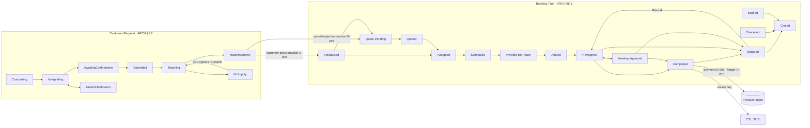

# Kaam Karo — Flow maps (T1.5)

Owner: A00. Task T1.5 (IMPL §6). Acceptance: **every arrow cites a state transition from ARCH §6**.
Inputs: `docs/screens/customer.md` (C01–C42), `docs/screens/partner.md` (P01–P26), `docs/screens/admin.md` (A01–A26), ARCH §6–§9, BP §9–§11, §15–§18, §40, §53, §56, §58, §61.3, §79, and owner decisions in `coordination/DECISIONS.md`.

## 0. How to read this file

- Each flow is a table. One row = one arrow.
- **Transition** uses the exact status names from ARCH §6. Machines:
  - **BK** = Booking/Job (ARCH §6.1, BP §15)
  - **RQ** = Customer Request (ARCH §6.2)
  - **FL** = Fare line / extra charge (ARCH §6.3, BP §58.2)
  - **QT** = Quote (ARCH §6.6)
  - **VF** = Provider verification (ARCH §6.4)
  - **RT** = Low-rating enforcement (ARCH §6.7, D-014/D-017)
  - **LG** = Provider account / ledger (ARCH §6.8, D-006/D-015/D-016/D-020/D-021)
- **Who** is the actor who *requests* the transition and the screen it happens on. The **server** always decides and records a Job Event (BP §15, §15.1). The app shows only server-confirmed status.
- **Guard** lists the server checks. **Event** is the ARCH §7 domain event (notifications fan out from events, BP §24).
- A "—" in Transition means the step changes no status (it is a read or a navigation). Such rows are kept only where they explain the flow.
- `[GAP]` marks a step that ARCH §6 does not define. Each gap points to an open question; nothing is invented.

---

## 1. Overview

Not drawn for clarity: Cancelled / Expired / Rejected / No-show exits (see §7).

---

## 2. Flow F1 — Smart request → match (BP §56, §79; ARCH §6.2)

| # | Transition | Who / screen | Guard (server) | ARCH | Event |
|---|---|---|---|---|---|
| 1.1 | RQ: (new) → Composing | Customer · C31 (tap "What do you need?"); optional C32 audio, C33 video, C38 voice | Logged-in account to submit (K-09 guest may only browse) | §6.2 | — |
| 1.2 | RQ: Composing → Interpreting | Customer sends input · C31 | IntakeAI interface (fake vendor, D-009 open); timeout + fallback to manual category pick (ARCH §8 rule 9) | §6.2 | — |
| 1.3 | RQ: Interpreting → NeedsClarification | IntakeAI · C31 asks one or two questions | Only when critical info is missing (BP §56.1 item 81) | §6.2 | — |
| 1.4 | RQ: NeedsClarification → Interpreting | Customer answers · C31 | — | §6.2 | — |
| 1.5 | — (location) | Customer confirms or corrects · C39 | Pakistan boundary + Lahore active area (D-007/D-019); permission asked on tap only (BP §75) | — | — |
| 1.6 | RQ: Interpreting → AwaitingConfirmation | IntakeAI · C34 shows the summary | AI may move the request **only up to here** (BP §67, §77.3) | §6.2 | — |
| 1.7 | RQ: AwaitingConfirmation → Submitted | **Customer only** · C34 "Confirm" | Idempotency key (ARCH §8 rule 3) | §6.2 | `request.submitted` |
| 1.8 | RQ: Submitted → Matching | Server | Hard eligibility BP §54.1 rules 73–79 + D-020 balance ≥ 0 (ARCH §9) | §6.2, §9 | — |
| 1.9a | RQ: Matching → MatchesShown | Server · C35 list with "why this provider" (BP §54.3) | Weights from config (D-010 open) | §6.2 | — |
| 1.9b | RQ: Matching → NoSupply | Server · C40 | No eligible provider | §6.2 | — (see F5) |
| 1.10 | → Booking created (see F2 / F3) | Customer picks one provider · C35 → C11/C14 (D-005: customer chooses, no auto-assign) | Provider still eligible at submit time | §6.2 last step | — |

Classic browse path (BP §9 steps 13–20): C06 → C07/C08/C09 → C10 → C11 → C12 → C14 joins the same booking flow at F2 step 2.1 or F3 step 3.1.

---

## 3. Flow F2 — Fixed price / choose-supplier booking → job → completion (BP §9, §10, §53)

| # | Transition | Who / screen | Guard (server) | ARCH | Event |
|---|---|---|---|---|---|
| 2.1 | BK: Draft → Requested | Customer · C14 "Confirm booking" → C15 | Service is Instant or Choose-from-Suppliers (BP §53); idempotency key; server computes the price (ARCH §8 rule 2) | §6.1 | `request.submitted` |
| 2.2 | BK: Requested → Accepted | Provider · P08 → P09 → P10 "Accept" with **crew size** (D-004) | Balance ≥ 0 (D-020); provider eligible (BP §54.1); crew size never changes price (D-018) | §6.1, §6.8 | `booking.accepted` |
| 2.3 | BK: Requested → Rejected | Provider · P10 "Decline" (no reason collected until OQ-065) | — | §6.1 fn² | `job.status_changed` |
| 2.4 | BK: Accepted → Scheduled | Server when the appointment time is set · P11 / C17 | Time inside provider availability (P06/P23, BP §59) | §6.1 | `booking.reminder` (later) |
| 2.5 | BK: Scheduled → Provider En Route | Provider · P12 "I'm on my way" | **Balance ≥ 0, else refused `UNPAID_COMMISSION`** (D-021). The customer never sees this provider-only reason (RQ-004) | §6.1, §6.8 | `provider.en_route` |
| 2.6 | BK: Provider En Route → Arrived | Provider · P12 "I've arrived" | — | §6.1 | `job.status_changed` |
| 2.7 | BK: Arrived → In Progress | Provider · P12 "Start work" | **Balance ≥ 0, else `UNPAID_COMMISSION`** (D-021) | §6.1, §6.8 | `job.status_changed` |
| 2.8 | BK: In Progress → Awaiting Approval | Provider proposes an extra · P13 → server; customer sees C37 | FL: line created as `Proposed` | §6.1, §6.3 | `charge.proposed` |
| 2.9a | FL: Proposed → Approved; BK: Awaiting Approval → In Progress | Customer · C37 "Approve" | Idempotency key; only the customer approves (BP §58.2) | §6.3, §6.1 | `job.status_changed` |
| 2.9b | FL: Proposed → Rejected; BK: Awaiting Approval → In Progress | Customer · C37 "Reject" | The rejected line can never become payable (BP §58.2) | §6.3, §6.1 | `job.status_changed` |
| 2.10 | BK: In Progress → Completed | Provider · P14 "Mark job complete" (+ P26 evidence where required, OQ-069); customer confirms on C20 | Who finalises Completed is open: provider mark vs customer confirm (OQ-044). Approved FL lines are summed into Final (§6.3) | §6.1, §6.3 | `job.status_changed` |
| 2.11 | BK: Awaiting Approval → Completed | Provider requests completion · P14 while an approval is open (BP §15 lists this transition) | Only approved FL lines count toward Final; an unanswered `Proposed` line is not payable (BP §58.2). Who finalises: same as 2.10 (OQ-044) | §6.1 | `job.status_changed` |
| 2.12 | → F4 payment | Customer · C20 → C16; Provider · P14 records CASH/DIGITAL | Only after `Completed` (D-003) | §6.8 | see F4 |
| 2.13 | — Review flag `review_submitted_at` | Customer · C21 (one rating per completed job, D-014) | Only an eligible completed job opens a review (BP §19) | §6.1 fn¹ "Reviewed" | — |
| 2.14 | BK: Completed → Closed `[GAP]` | — | BP §15 / ARCH §6.1 list only *Reviewed* and *Disputed* after Completed. When and how a Completed booking reaches `Closed` is not defined → **OQ-073** | §6.1 | — |

---

## 4. Flow F3 — Quote / inspection booking (BP §18, §53 "Request Quotes / Offers"; D-028)

| # | Transition | Who / screen | Guard (server) | ARCH | Event |
|---|---|---|---|---|---|
| 3.1a | BK: Draft → Quote Pending | Customer submits on a quote-required / inspection service · C14 or C34 | Service model = Request Quotes (BP §53); D-028 | §6.1 fn³ | `request.submitted` |
| 3.1b | BK: Requested → Quote Pending | Provider chooses "Quote" · P10 | D-028 | §6.1 fn³ | — |
| 3.2 | — Inspection visit (inside Quote Pending) | Provider and customer agree a visit time (who proposes: OQ-066); P09 / C17 | No status change; visit time stored on the booking (D-028). No inspection fee at launch (D-023) | §6.1 fn³ | `booking.reminder` |
| 3.3 | QT: Draft → Sent; BK: Quote Pending → Quoted | Provider · P24 structured quote with typed lines and crew size | Balance ≥ 0 (D-020); validity date (BP §18 step 58; value D-013 open); simple-total quote vs labour commission is open (OQ-067) | §6.6, §6.1 | `quote.received` |
| 3.4 | — Compare offers | Customer · C13 (one quote) or C36 (several offers, BP §53) | Server shows only Sent, unexpired quotes | §6.6 | — |
| 3.5 | QT: Sent → Accepted; BK: Quoted → Accepted | Customer · C13/C36 "Accept" | Idempotency key; the accepted quote becomes the commercial basis (BP §18 step 61) | §6.6, §6.1 | `booking.accepted` |
| 3.6 | QT: Sent → Declined; BK: Quoted → Cancelled (reason `QUOTE_DECLINED`) **or** stays open if other offers exist | Customer · C13/C36 "Decline" | Multi-quote handling per ARCH §6.1 fn¹ | §6.6, §6.1 fn¹ | `job.status_changed` |
| 3.7 | QT: Sent → Expired; BK: Quoted → Expired → Closed | Server job at validity end | Validity value D-013 open | §6.6, §6.1 | `job.status_changed` |
| 3.8 | BK: Quote Pending → Rejected / Expired / Cancelled | Provider declines (P10) / server timeout / customer cancels (C17) | Windows D-013 open; no cancellation fee (D-023) | §6.1 | `job.status_changed` |
| 3.9 | QT: Sent → Withdrawn | Not offered on P24 until OQ-068 is answered | — | §6.6 | — |
| 3.10 | Accepted → continues at F2 step 2.4 | — | After acceptance, any price/scope change goes through FL (F2 step 2.8, BP §18 step 62) | §6.6, §6.3 | — |

---

## 5. Flow F4 — Payment and provider ledger (D-003, D-006, D-015, D-016, D-025, D-029)

| # | Transition | Who / screen | Guard (server) | ARCH | Event |
|---|---|---|---|---|---|
| 4.1 | — Bill shown | Customer · C20 / C16: lines per BP §58.1, separate tax line (D-029), **no platform fee** (D-025), no commission shown to the customer | Booking is `Completed` (D-003) | §6.8 | — |
| 4.2 | LG: record method CASH → **DEBIT** 30% × labour lines | Provider · P14 "Confirm cash payment" | Only Labor/Service fee lines are commissionable (D-015, `commission.rate = 0.30` D-006); CASH refused if a confirmed digital payment exists; idempotent | §6.8 | `provider.commission_debited` |
| 4.3 | LG: record method DIGITAL → wait for the gateway | Provider · P14; Customer pays · C16 | Gateway is a fake until D-008; a credit is written **only on gateway confirmation** | §6.8 | `payment.succeeded` / `payment.failed` |
| 4.4 | LG: **CREDIT** = bill − 30% × labour | Server on gateway confirmation | Append-only ledger rows (BP §26) | §6.8 | `payment.succeeded` |
| 4.5 | LG: balance < 0 → provider blocked from new hires | Server after 4.2 | `ledger.max_negative_balance` = 0 (D-020) | §6.8 | `provider.balance_negative` |
| 4.6 | — Receipt and history | Customer · C24; Provider · P15 | — | §6.8 | — |

### F4b — Unpaid commission: "Pay company" (D-020, D-021)

| # | Transition | Who / screen | Guard (server) | ARCH | Event |
|---|---|---|---|---|---|
| 4b.1 | LG: balance < 0 → hiring block on (no match, no accept, no quote; no start of accepted jobs) | Server | D-020, D-021 | §6.8, §9 | `provider.balance_negative` |
| 4b.2 | LG: payment submission `Submitted` | Provider · P15 "Pay company": transaction ID + optional screenshot (system photo picker, BP §75 item 97) | The provider's own claim never clears the block | §6.8 step 2–3 | `provider.commission_payment_submitted` |
| 4b.3a | LG: Finance **approves** → audited CREDIT row | Finance · A09 verification queue | Finance sub-role only; reason + audit (BP §26, §8.4); amount mismatch handling open (OQ-059) | §6.8 step 4 | — |
| 4b.3b | LG: Finance **rejects** with reason | Finance · A09 | Reason required | §6.8 step 4 | `provider.commission_payment_rejected` |
| 4b.4 | LG: balance ≥ 0 → block off automatically | Server | — | §6.8 step 5 | `provider.balance_cleared` |

---

## 6. Flow F5 — Supply gap (BP §61.3; ARCH §6.2)

| # | Transition | Who / screen | Guard (server) | ARCH | Event |
|---|---|---|---|---|---|
| 5.1 | RQ: Matching → NoSupply | Server · C40 explains why (never a blank screen) | — | §6.2 | — |
| 5.2 | RQ: NoSupply → Matching (wider radius) | Customer · C40 "Search a wider area" | Radius limits from config | §6.2 | — |
| 5.3 | RQ: NoSupply → Matching (other time) | Customer · C40 "Choose another time" | — | §6.2 | — |
| 5.4 | RQ: NoSupply → Matching (related service) | Customer · C40 "Try {related service}" | Related-service map from catalog (BP §64) | §6.2 | — |
| 5.5 | RQ stays NoSupply; callback ticket created | Customer · C40 "Ask Kaam Karo to call me" → Operations · A12 | Default per OQ-021 | §6.2 | — |
| 5.6 | RQ stays NoSupply; waitlist entry stored | Customer · C40 "Join the waitlist" → A25 health metrics | No automatic "notify when available": that is **Proposed** (BP §83, §86), not built | §6.2 | — |

`[GAP]` ARCH §6.2 does not name a transition *out of* NoSupply. Rows 5.2–5.4 read it as "re-enter Matching with changed inputs", which is what BP §61.3 asks for. Confirm under **OQ-074**.

---

## 7. Flow F6 — Cancellation, expiry, rejection, no-show (BP §16; D-013, D-023)

| # | Transition | Who / screen | Guard (server) | ARCH | Event |
|---|---|---|---|---|---|
| 6.1 | BK: Requested → Cancelled | Customer · C17 "Cancel booking" (reasons OQ-050) | Before acceptance: no fee (BP §16) | §6.1 | `job.status_changed` |
| 6.2 | BK: Accepted / Scheduled / Provider En Route / Arrived → Cancelled | Customer (C17) or provider (P09/P12 "Cancel this job", reasons OQ-065) | **No late-cancellation fee at launch** (D-023). Windows D-013 open. Provider cancel → replacement/refund path for the customer, reliability affected (BP §16) | §6.1 | `job.status_changed` |
| 6.3 | BK: Requested / Quote Pending → Expired | Server timeout | Window D-013 open | §6.1 | `job.status_changed` |
| 6.4 | BK: Requested / Quote Pending → Rejected | Provider · P10 "Decline" (no reason collected until OQ-065) | — | §6.1 fn² | `job.status_changed` |
| 6.5 | BK: Scheduled / Provider En Route → No-show (`party = CUSTOMER\|PROVIDER`) | Provider reports a customer no-show after a controlled wait; customer reports a provider no-show (C17 → C29/C28) | Wait period config (D-013 open); **no customer no-show fee at launch** (D-023) | §6.1 fn² | `job.status_changed` |
| 6.6 | BK: Cancelled / Expired / Rejected / No-show → Closed | Server | — | §6.1, fn² | — |
| 6.7 | D-021 unpaid start: Scheduled booking not started because of `UNPAID_COMMISSION` → treated as a provider cancellation | Server after `ledger.unpaid_start_grace_minutes` (null, `TODO(OWNER)`, D-022) | `[INTERPRETATION]` in ARCH §6.8; OQ-007 | §6.1, §6.8 | `job.status_changed` |

---

## 8. Flow F7 — Dispute (BP §16, §40; ARCH §6.1 fn¹)

| # | Transition | Who / screen | Guard (server) | ARCH | Event |
|---|---|---|---|---|---|
| 7.1 | BK: In Progress / Awaiting Approval / Completed → Disputed | Customer · C29 "Report a problem" (from C19/C20/C22). Provider: only via the P12 safety stop (row 7.4b); P20 Support opens a ticket, not a dispute | Allowed only from these statuses (BP §15) | §6.1 | `dispute.opened` |
| 7.2 | — Triage by level | L1 self-help (C28) → L2 Support (A12) → L3 Operations (A10) → L4 Risk/Finance (A10/A18/A09) → L5 senior owner (sub-role OQ-061) | Sub-role access per `admin.md` matrix; every action audited with a reason (BP §8.3) | — | `dispute.updated` |
| 7.3a | Dispute outcome *Resolved*; BK: Disputed → Closed | Operations (L3) or Risk/Trust (L4) · A10 "Resolve" / "Close" | Outcome stored on the Dispute record, not as a booking status | §6.1 fn¹ | `dispute.updated` |
| 7.3b | Dispute outcome *Refunded*; BK: Disputed → Closed | Operations (L3) or Risk/Trust (L4) · A10 "Decide refund"; Finance then issues the refund (A09/A10) | Refund on cash-paid jobs and partial refunds open (OQ-058); ledger reversal rows, never edits (BP §26) | §6.1 fn¹, §6.8 | `refund.issued` |
| 7.3c | Dispute outcome *Rework*; BK: Disputed → In Progress | Operations (L3) or Risk/Trust (L4) · A10 "Send back for rework" | Continues at F2 step 2.8 | §6.1 fn¹ | `job.status_changed` |
| 7.4a | BK: Arrived → Cancelled (safety stop) | Customer · C17/C19 "Stop for safety"; provider · P12 "Stop — safety problem" | BP §16 last row; safety-flagged support ticket created; no fee (D-023) | §6.1 | `job.status_changed` |
| 7.4b | BK: In Progress → Disputed (safety stop) | Customer · C19 "Stop for safety"; provider · P12 "Stop — safety problem" | BP §16 last row; safety-flagged ticket; emergency charge rules stay disabled (K-10) | §6.1 | `dispute.opened` |

---

## 9. Flow F8 — Provider onboarding and verification (BP §10, §22; ARCH §6.4)

| # | Transition | Who / screen | Guard (server) | ARCH | Event |
|---|---|---|---|---|---|
| 8.1 | — Account via phone + OTP | Provider · P01 → P02 (D-002; login step OQ-062) | OTP limits from config (T2.4) | — | — |
| 8.2 | — Services, area, hours | Provider · P05, P07, P06 | Only active Lahore families (D-024) | — | — |
| 8.3 | — VF starts at Basic (initial level, ARCH §6.4); verification submitted | Provider submits · P03 | Only the team leader is verified (D-018); documents per category from config | §6.4 | — |
| 8.4 | VF: Basic → Verified → Business Verified | Admin · A04 | Sub-role per `admin.md` matrix; reason + audit; result notice to provider has no ARCH §7 event yet → **OQ-075** | §6.4 | `[GAP]` |
| 8.5 | — Provider eligible for matching | Server | BP §54.1 rule 77 | §6.4, §9 | — |

---

## 10. Flow F9 — Low-rating enforcement (D-014, D-017; ARCH §6.7) — **dry-run at launch**

| # | Transition | Who / screen | Guard (server) | ARCH | Event |
|---|---|---|---|---|---|
| 9.1 | RT: Good standing → Warning 1 | Server job | Avg rating **< 2.0** (`rating.block_threshold`, D-017); min reviews, period and window open (`null`, `TODO(OWNER)`) → **dry-run only** | §6.7 | `provider.rating_warning` |
| 9.2 | RT: Warning 1 → Warning 2 | Server job after the review period | Same | §6.7 | `provider.rating_warning` |
| 9.3 | RT: Warning 2 → Blocked (low rating) | Server job | `rating.warnings_before_block` = 2; dry-run until D-017 is complete | §6.7 | `provider.blocked_low_rating` |
| 9.4 | RT: Warning n → Good standing | Server when avg ≥ threshold | Reset rule is `[INTERPRETATION]` (D-017) | §6.7 | — |
| 9.5 | RT: Blocked → Good standing (reinstate) | Operations or Risk/Trust · A03/A18 | Reason + audit (BP §8.3) | §6.7 | — |

Provider sees warnings on P04/P17/P19. Admin queue: A18.

---

## 11. Coverage check

| BP journey | Covered by |
|---|---|
| §9 Customer journey steps 11–26 | F1, F2, F3, F4, F6, F7 (C-screen mapping in `customer.md` "BP §9 journey" section) |
| §10 Provider journey steps 27–42 | F8, F2, F3, F4, F7 |
| §11 Admin journey steps 43–54 | F4b (A09), F7 (A10/A12), F8 (A04), F9 (A18); A02/A16/A19/A25 dashboards change no status. Step 52 "publish operational updates" is not specified (OQ-056) |
| §15 every BK status | Draft, Requested, Quote Pending, Quoted, Accepted, Scheduled, Provider En Route, Arrived, In Progress, Awaiting Approval, Completed, Disputed, Cancelled, Expired, Closed — all appear above; Completed → Closed is `[GAP]` OQ-073 |

## 12. Gaps raised by this file

| OQ | Gap |
|---|---|
| OQ-073 | BK: how a `Completed` booking reaches `Closed` (BP §15 lists only Reviewed/Disputed after Completed) |
| OQ-074 | RQ: transitions out of `NoSupply` are not named in ARCH §6.2 |
| OQ-075 | No ARCH §7 event tells the provider the verification decision (A04 → P03/P19) |

Related, already open: OQ-007, OQ-009, OQ-021, OQ-044, OQ-050, OQ-056, OQ-058, OQ-059, OQ-061, OQ-062, OQ-065, OQ-066, OQ-067, OQ-068, OQ-069; D-008, D-010, D-013, D-017, D-022.
